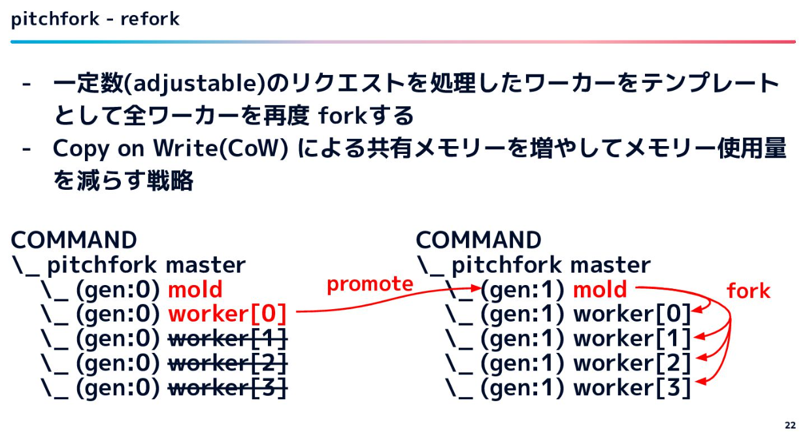

# pitchfork

- [スパイクアクセス対策としての pitchfork 導入 - Speaker Deck](https://speakerdeck.com/riseshia/introducing-pitchfork-as-a-countermeasure-for-traffic-spikes?slide=30)
  - unicornのfork
  - reforkという機能がある
    - forkでありつつもCoWで省メモリかつウォームアップ済みでワーカーを増やせる
  - 
  - _** 一定数のリクエストを処理したworkerプロセスがmoldプロセスになる
    - デプロイが直後こそunicornと変わらないが、時間が経つにつれて、新規に作られるworkerプロセスが「既に温まったプロセスからforkして」作られるので、最初から温まった状態で作られる
- [The Pitchfork Story | byroot’s blog](https://byroot.github.io/ruby/performance/2025/03/04/the-pitchfork-story.html)
  - 誕生秘話
  - OS側にCoWの機能があるが、MRIのVMインラインキャッシュの仕組みが書き込みを行うせいで、OS側のCoWがほぼ意味を為していなかった。なので、程々に温まったプロセスができたらそれを新しいforkのテンプレートにするような仕組みで解決した
- [スタディサプリ最大のRailsアプリケーションにYJIT+pitchforkを導入してメモリ使用量を劇的に削減するまで - スタディサプリ Product Team Blog](https://blog.studysapuri.jp/entry/2024-pitchfork-into-the-largest-rails-application-in-studysapuri)
  - 導入事例
- 導入する際の参考
  - [DEV: Add Pitchfork alongside Unicorn by Flink · Pull Request  · discourse/discourse](https://github.com/discourse/discourse/pull/35370)
    - discourse というwebサービスのリポジトリにおいて導入したときのPR
  - [pitchfork/docs/CONFIGURATION.md マスター · Shopify/pitchfork](https://github.com/Shopify/pitchfork/blob/master/docs/CONFIGURATION.md)
    - 設定ファイルの説明
