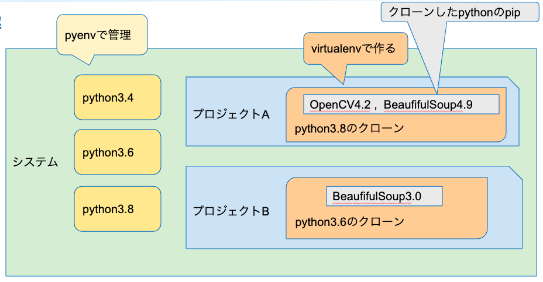

# python

- 公式リンク
  - https://www.python.jp
  - https://docs.python.org/ja/3
- **pythonメモ**
  - `import pdb; pdb.set_trace()` でpry的なreplが立ち上がる
  - with文でブロックを1つ作ると、ブロック終了時に呼び出した関数が予め定義した後処理をしてくれる
    - rubyの`File.open(){}`の感じかも
    - rubyでのnewのinitializeの感じかも
  - 二次元配列の初期化
    - `[ [ { "x": 0, "y": 0, "flag": False } for w in range(width) ] for h in range(height) ]`
  - 直積
    - `for y, x in itertools.product(range(height), range(width)):`
  - デコーレーター
    - `@deco_func`みたいな@から書いて、次にメソッド定義を書く。
    - `def deco_func:`が予め定義されてる必要がある
    - Rubyで例えると、deco_funcメソッドのブロックに`@deco_func`以下の処理を渡すイメージ?
  - クラスメソッド
    - こんな感じに書く
      - 第一引数は自身のクラスが入る
**main.py**

```
class Klas:
    @classmethod
    def class_method(cls, arg):

```

- listをイテレーター
  - `for index, hoge in enumerate(hoges):`
- python組み込み関数 [組み込み関数 — Python 3.8.2 ドキュメント](https://docs.python.org/ja/3/library/functions.html)
- Rubyとは違ってファイルに分けるとその時点で名前空間が作られるらしい
- [Python におけるモジュールとパッケージは「名前空間」 - Qiita](https://qiita.com/sukobuto/items/15c1173b3f37f0306dd5)
- mapで返されるものはリストではない?
  - イテレーターなのかも
  - 内包表記だとリスト?
- `f"{hoge}"`で文字中の式展開できる
- `r"rege.*xp"`でraw文字列
- `BeautifulSoup`の第2引数に、パーサーエンジンをしていする
- if, for, whileはスコープ作らない
  - withも作らない
- 関数定義時に未定義の変数があったときは、その時の環境にその変数があればそれが使われる
  - [変数のスコープ - Qiita](https://qiita.com/yoichi22/items/8ae2ca180407a5ad5a6d)
- **バージョン管理**
  - どのような管理方法があるか
  - [仮想環境 バージョン管理 まとめ Python - Qiita](https://qiita.com/hedgehoCrow/items/0733c63c690450b14dcf)
  - 3種類ありそう。virtualenvをつかってみる
  - windowsでも使えるのと、作った環境がプロジェクト内で完結しそう
  - 使い方
    - [virtualenvをgitで管理すると便利 - Qiita](https://qiita.com/m-masaki72/items/7ba34e31d9f08662f1ee)
  - virtualenv
    - pythonのバージョンを管理できる
  - pipでは、gemコマンドと同じように、モジュールのバージョンは1つしか入らない
  - pythonとモジュールを固定&共存する方法
    - pyenvでpythonインストール
    - virturalenvでそのインストールしたpythonをクローン
    - virtualenvのpipで、必要なものをpip install(venv/bin/pip から)
  - pyenv shell 2.2.2 みたいな書き方で、現在のシェルでだけそのバージョンを使える
    - rbenvとかも同じ
  - pyenv, virturalenv, 図にすると
- 
  - [Python パッケージングの標準を知ろう - Tech Blog - Recruit Engineer](https://engineer.recruit-lifestyle.co.jp/techblog/2019-12-25-python-packaging-specs/)
