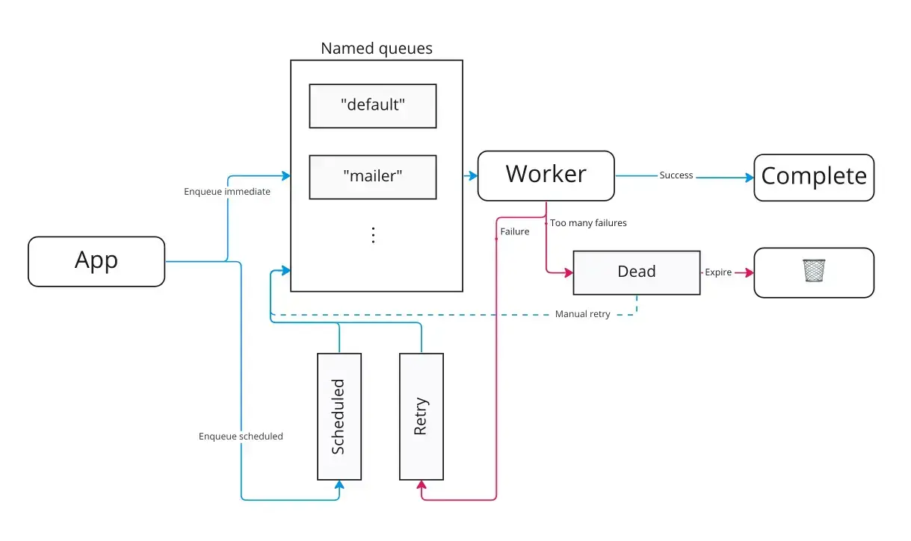

# sidekiq

- [Advanced Options · sidekiq/sidekiq Wiki · GitHub](https://github.com/sidekiq/sidekiq/wiki/Advanced-Options)
  - sidekiqに指定できるオプションの指定が載ってる
  - `sidekiq_options`で指定できるオプションも載ってる
    - `queue:`
      - デフォルトは`default`queue
    - `retry:`
      - デフォルトtrue
        - **デフォルトだと25回リトライする**
        - 徐々に時間を開けてリトライする
      - リトライ回数を指定できる
      - **そもそもjobを作るときはエラーでリトライをするかどうかを検討しよう！**
    - `dead:`
      - 失敗したjobをDead queue送りにするか
      - デフォルトtrue
    - `backtrace:`
      - エラー時にバックトレースをredisに残すかどうか
      - デフォルトfalse
    - `pool:`
      - どのpoolにいれるか
    - `tags:`
      - 管理画面で検索用にタグを付けれる
- Active Jobとの関係
  - [Active Job の基礎 - Railsガイド](https://railsguides.jp/active_job_basics.html)
  - [【Active Job】Sidekiq vs Resque vs Delayed Job](https://zenn.dev/shima_zu/articles/rails_active_job)
    - >バックグラウンドで実行するジョブをRailsアプリケーションで動かすための共通インターフェイスです。
- How does Sidekiq work?
- [障害対応等でSidekiq APIを使うときのTips | Wantedly Engineer Blog](https://www.wantedly.com/companies/wantedly/post_articles/452938)
  - キュー
  - >以下のキューがあります。
    - Sidekiq::Queue ... 通常の名前つきキュー。時間指定なしでエンキューされたジョブはここに入る。
    - Sidekiq::ScheduledSet ... 時刻待ちのジョブが入っているキュー。
    - Sidekiq::RetrySet ... 実行に失敗し、次の実行時間を待っているジョブのためのキュー。
    - Sidekiq::DeadSet ... 実行に失敗し、もはや自動では再実行されないジョブのためのキュー。
  - 正確には、後の3つはQueueではなくSortedSetとして実装されており、 Sidekiq::JobSet を継承していま
  - []
- このように書くと、defaultなjobがたくさん来ても、最低限1/4はlowなjobを捌いてくれるようになる
**sidekiq.yml**

```
:queues:
  - ["default", 3]
  - ["low", 1]
```

- こっちの普通の書き方だと上が優先される
**sidekiq.yml**

```
:queues:
  - invoices
  - low

```

- sidekiqの引数にキーワード引数は対応していない...
  - https://github.com/sidekiq/sidekiq/wiki/Best-Practices
    - > Don't pass symbols, named parameters, **keyword arguments** or complex Ruby objects (like Date or Time!)
    - hashならOK
  - [Sidekiq アンチパターン: 序 - SmartHR Tech Blog](https://tech.smarthr.jp/entry/2017/04/20/165555)
    - > また、Sidekiq は今のところキーワード引数も使えませんので、運用上引数の増減が予想されるようなワーカーでは、引数に Hash を使うとよいでしょう。そもそも、最低限のパラメータはモデルに持たせるのがよいですね！
