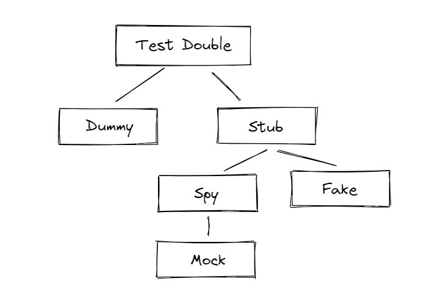

# stubとmockとdoubleとspyとdummyとFakeの違い

- [Rails tips: RSpecのスタブとモックの違い（翻訳）｜TechRacho by BPS株式会社](https://techracho.bpsinc.jp/?p=55467)
- [Test Double のタイプ達 - A Memorandum](https://blog1.mammb.com/entry/2023/02/27/194826)
- 
**Test Double のタイプの比較(引用)**

| タイプ | 間接入力の提供 | 間接出力の記録 | 間接出力の検証 |
| --- | --- | --- | --- |
| ダミー(Dummy) | × | × | × |
| スタブ(Stub) | 〇 | × | × |
| スパイ(Spy) | 〇 | 〇 | × |
| モック(Mock) | 〇 | 〇 | 〇 |
| フェイク(Fake) | 〇 | × | × |

- 間接入力
  - >テスト対象メソッド内で、テストダブルが返却する戻り値を利用する(テストダブルのメソッド呼び出しによりテストで利用する戻り値を提供する)
- 間接出力
  - >テスト対象メソッド内から、テストダブルのメソッドを特定の引数を伴って行われる呼び出し
- double
  - 一番大きな分類。下記全部を含む総称
  - [rspec]の`double`をすると作られるのは、下記の中だとdummyが近そう。作ったdummyに対して`allow`や`expect`メソッドとかを使っていくことで、stubやmockになっていく
- stub
  - 置き換えるだけ
  - [rspec]の`allow`
- spy
  - 置き換える & 呼ばれてたことを記録する
  - 自身が検証能力を持っているのがmockで、持っていないのがspy
  - spyが記録した呼び出しは、spy自身ではない別のテストコードで検証する
- mock
  - 置き換える & 呼ばれてたことを(記録しつつ)検証する
  - [rspec]の`expect`
- dummy
  - 実行するうえで必要だが、テスト対象としては無関係なもの(挙動については関心の無いもの)
- fake
  - > テスト対象から利用する、本物のコンポーネントと同等の挙動を行うオブジェクト。これ自体には(モックに有るような)検証の振る舞いは含まず、多くの場合実際のオブジェクトに近い働きをするが、より単純な実装となる。
  - >テスト時に利用するインメモリデータベースがその例となる
- 「インターフェースは一致しているからこっちを使おう」のようなもの？
