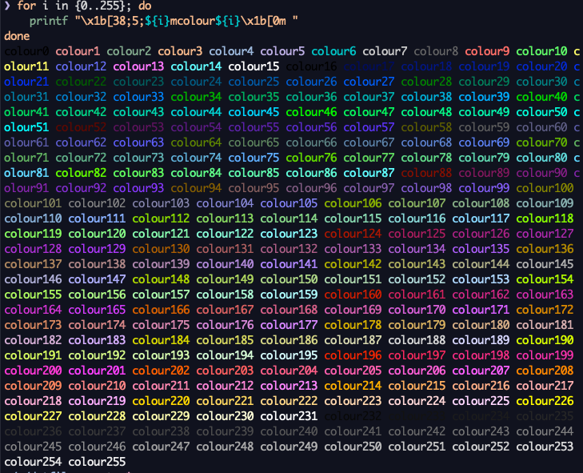

# tmux

- ドキュメント
  - https://man7.org/linux/man-pages/man1/tmux.1.html
- window-status-formatでtmuxの設定値を計算したいとき
  - tmux内で`tmux`コマンドを打つと、現在の設定値が手に入る
  - `tmux display-message -p '#I'`のように
  - これをシェルで計算して、結果を使えばよい`#(tmux display-message -p '#I' | rr 'to_i.next')`
- 色一覧
  - https://blog.anderiens.com/entry/tmux-color-palette
- []
