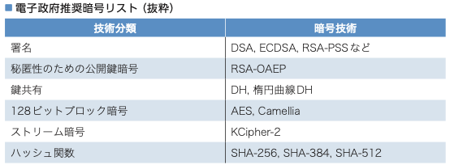

# アルゴリズムと安全性

## 暗号と認証のしくみと理論がこれ1冊でしっかりわかる教科書

- [図解即戦力 暗号と認証のしくみと理論がこれ1冊でしっかりわかる教科書：書籍案内｜技術評論社](https://gihyo.jp/book/2021/978-4-297-12307-9)

- **2章 アルゴリズムと安全性**
- **05 アルゴリズム**
- **06 安全性**
- **07 暗号技術の危殆化**
- 
