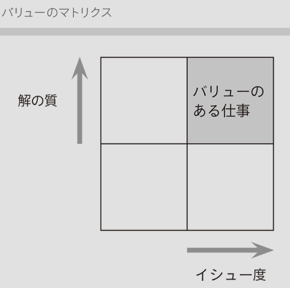

# イシューからはじめよ

- はじめに　優れた知的生産に共通すること
- 序章　この本の考え方―脱「犬の道」
  - 悩まない。考えよう
  - 生産性=output/input
  - 
    - 必要度が高い問題に対して、明確な答えを出すこと
    - →↑ の順でやる。↑→は犬の道
- 第１章　イシュードリブン―「解く」前に「見極める」
  - 行動を起こす前に、**何に答えを出す必要があるのか**を考える
    - 何を明らかにする必要があるのか
    - やらなくてもいいことはやらないようにしたい
  - イシューの見極めは相談できる人がいるとよい
  - 仮説(仮の答え・仮の方針)を立ててから分析を始める
  - イシューは言語化する
    - WHERE: どこを目指すのか
    - WHAT: 何を行う・避けるべきか
    - HOW: どう進めるべきか
    - (WHY を言葉にしてもその仮説が無いのでよくない)
    - 比較して言語化するとわかりやすくなる
  - イシュー特定のための情報収集
    - あまり時間をかけるのはよくない
      - 検証までのサイクルを早く回したい
    - コツ
    - 1. 1次情報
    - 2. 基本的な情報
      - 数字
      - 問題意識
      - フレームワーク
        - 課題をどのような形で整理・分析しているか
    - 3. 集めすぎない
- 第２章　仮説ドリブン（１）―イシューを分解し、ストーリーラインを組み立てる
- 第３章　仮説ドリブン（２）―ストーリーを絵コンテにする
- 第４章　アウトプットドリブン―実際の分析を進める
- 第５章　メッセージドリブン―「伝えるもの」をまとめる
- おわりに　「毎日の小さな成功」からはじめよう
