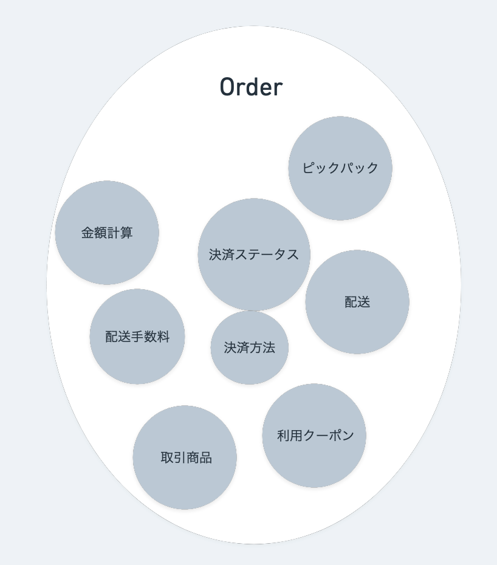
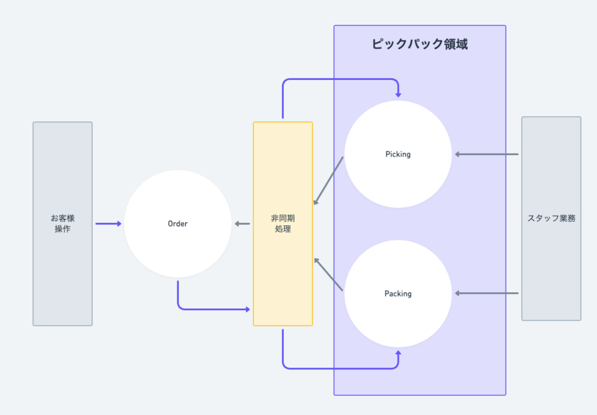

# イベント駆動アーキテクチャ

- [お届けチームがイベント駆動アーキテクチャを採用した理由 - 10X Product Blog](https://product.10x.co.jp/entry/2025/03/26/105353)
  - もともと密結合で、1つの障害が全体の障害になっていた
  - Eventarc というイベント駆動のためのサービスを利用
  - ユビキタス言語辞書を作る
  - > ── イベント駆動アーキテクチャを導入してみて、実際にどんな恩恵が得られましたか？
  - > 保守性の話にも繋がると思うんですけど、イベント駆動で開発をするとイベントを大事にするからモデリングをしっかりする、といったようにモデリングする動機付けになったという部分があります。
- [技術的チャレンジへつながるピックパックのモジュール化 | お届けチーム取組紹介 - 10X Product Blog](https://product.10x.co.jp/entry/2025/04/10/150702)
  - 
    - たくさんの領域の関心ごとがOrderにいる図
  - → データモデルとコードの分離をした
  - 
    - 領域が非同期処理によって連携する
    - > Orderとピックパックの間の影響関係がインターフェースを通じて明確に
- [イベント駆動設計を支える非同期処理について | お届けチーム取組紹介 - 10X Product Blog](https://product.10x.co.jp/entry/2025/05/30/093811)
  - EventarcによってFirestoreの書き込みをトリガーをにして、ドキュメントを非同期メッセージとしてCloud Runに送りつけ
  - 監視やリトライ設定はCloud Pub/Subへの設定で
