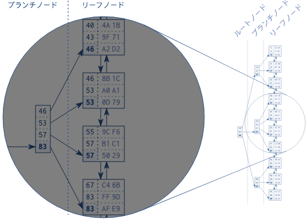

# インデックス

- インデックスのしくみ
  - [SQLインデックスの内部構造 : SQLインデックスとは何か](https://use-the-index-luke.com/ja/sql/anatomy)
  - データ構造
    - 双方向連結リスト
    - 検索木
      - バランス木
  - ツリーの構造
    - 
      - >各ブランチノードの中身は、それぞれのリーフノードの最大値です。最初のリーフノードの最大値は46なので、ブランチノードの最初の要素も 46になっています。
  - インデックスの使われ方
    - `INDEX UNIQUE SCAN`
      - 木の走査のみ
    - `INDEX RANGE SCAN`
      - 木の走査 & リーフノードチェーンをたどった検索
    - `TABLE ACCESS BY INDEX ROWID`
      - テーブルから行を読み出す
