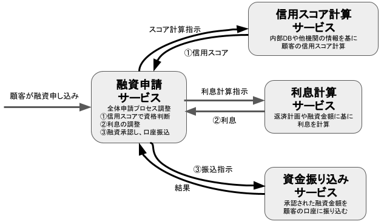

# インフラ設計

- [クックパッドの検索反映時間を 1/288 にしたシステム改修 - クックパッド開発者ブログ](https://techlife.cookpad.com/entry/2023/10/05/150000)
  - システム設計とシステム移行の両方の面でお手本のような改修をしていてすごい
- [大規模サービスのデータベースエンジンを MySQLからAurora MySQLへの移行 〜リードレプリカ, DNSを利用した最小ダウンタイム移行方法〜 - メドピア開発者ブログ](https://tech.medpeer.co.jp/entry/2023/08/21/095251)
  - >AuroraとRailsを組み合わせて使用すると、Railsのコネクションプールの仕組み上、フェールオーバー時に新しいライターへのコネクション切り替えが自動的に行われず、リーダー(旧 ライター)にデータの書き込みを行ってしまう事象が知られています。これにより、予期せぬタイミングでデータ更新ができない状況が発生します。
    - 再接続を行うミドルウェアを開発
      - >このミドルウェアは、RailsのActionDispatch::ContentSecurityPolicy::Middlewareより先に呼び出されるよう設定しました。
- [pixivコミックストアの作品検索機能をMySQLの全文検索からElasticsearchに移行しました - pixiv inside](https://inside.pixiv.blog/2023/10/02/170000?utm_source=feed)
  - MySQLの全文検索 → Elasticsearch
    - AWSではなく自前のやつ
    - AWSのやつはたしか権利周りの問題でAmazon OpenSearch Serviceという名前に変わったはず
  - elasticsearch gem
  - どこまでの情報をElasticsearch側に持たせるかについて議論している
  - DBとElasticsearchの同期はバッチ処理で行う
- ドリコムライブラリ大公開
  - [activerecord-turntable | PPT](https://www.slideshare.net/drecom/activerecordturntable)
    - https://github.com/drecom/activerecord-turntable
  - 水平スケーリングの自作gemについて紹介している
- Saga
  - [マイクロサービス実装に不可欠「Saga」とは \| GMOアドパートナーズ TECH BLOG byGMO](https://techblog.gmo-ap.jp/2023/10/20/microservice_saga/)
    - 概要
      - > Sagaはマイクロサービスアーキテクチャで分散トランザクションを**使わずに**データ整合性を維持するためのメカニズムです
        - 分散トランザクション：複数のサービスにまたがるトランザクション。大変。
    - しくみ
      - >Sagaパターンでは、非同期メッセージングで構成された一連のローカルトランザクションを使って、複数のサービスにまたがるサービスのデータ整合性を維持します。
      - >各トランザクションは独立してコミットまたはロールバックが可能で、
      - >仮に何かしらの問題が途中で発生した際には「補償トランザクション」と呼ばれる仕組みを用いて、すでに行われた操作を打ち消します。
    - 利点
      - 柔軟性
      - スケーラビリティ
      - 障害回復
    - 欠点
      - 複雑性
      - レイテンシの増加
    - トランザクションの調整方法
      - 詳しくは記事へ
      - 
    - 実装例
      - 詳しくは記事へ
  - AWSで実現するモダンアプリケーション入門 でも説明されていた
- [Redis Pub/Subを使って、ライブ配信の同時視聴数を10倍増やした話 | CyberAgent Developers Blog](https://developers.cyberagent.co.jp/blog/archives/48240/)
  - Redis
- [バックエンド技術討論会「ユーザー数〇〇万人の大規模サービスを支えるデータストアとキャッシュ戦略」 - YouTube](https://www.youtube.com/watch?v=tYn_xF5vPtI)
