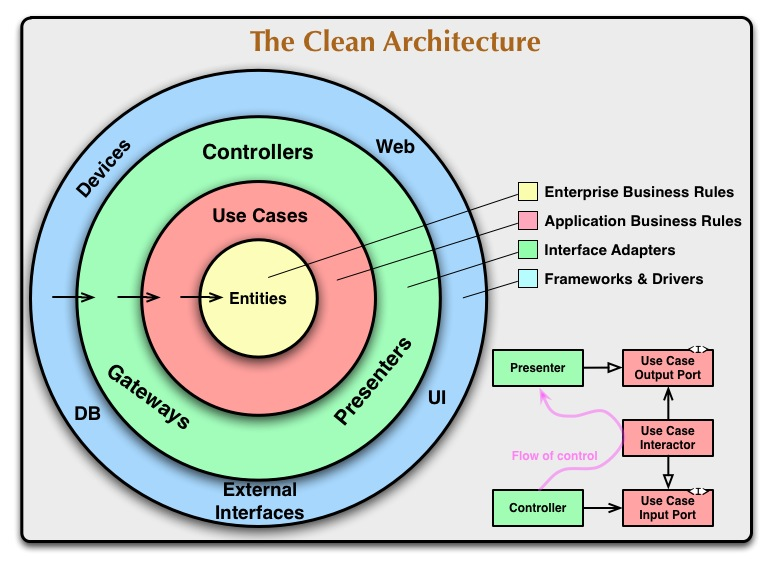

# クリーンアーキテクチャ

- 
  - レイヤー
    - エンティティー層
      - ビジネスロジック
      - ここ中心に
    - ユースケース層
      - Interactor
      - ビジネスロジックのAPI
    - プレゼンテーター、コントローラー、ゲートウェイ層
      - IO, 永続化
      - Repository
        - >リポジトリパターンで知られ、特定のモデルのデータ永続化について抽象化したものです
      - >緑色レイヤーの Interface Adapters は入力、永続化、出力が所属します。
    - インターフェース層
      - >ここは Web フレームワークやデータベースのドライバーなどのギークなコードが所属します。
  - 内側のレイヤーにのみ依存する
