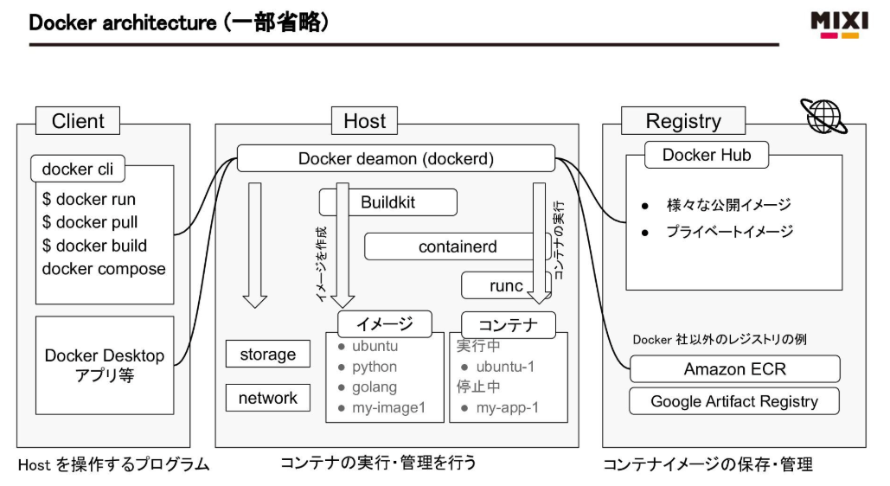
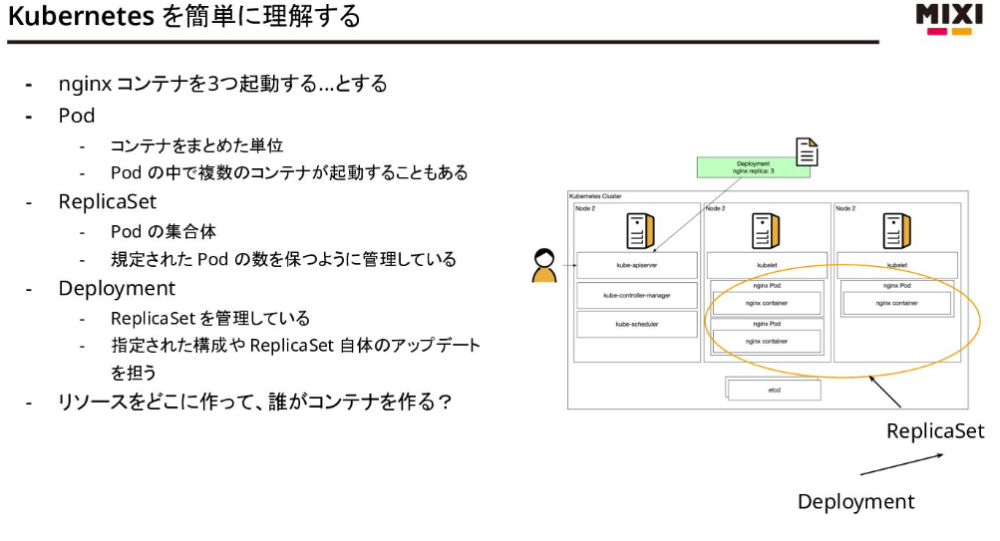
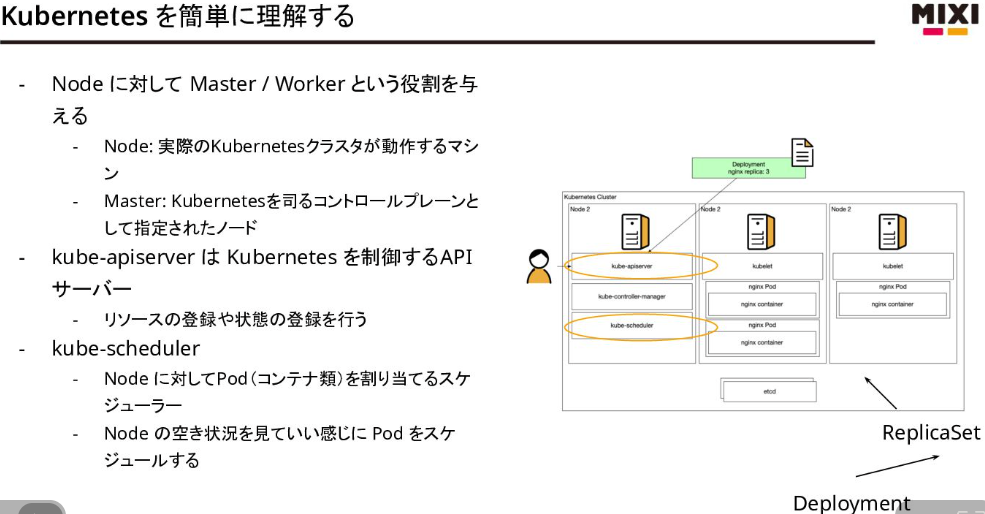
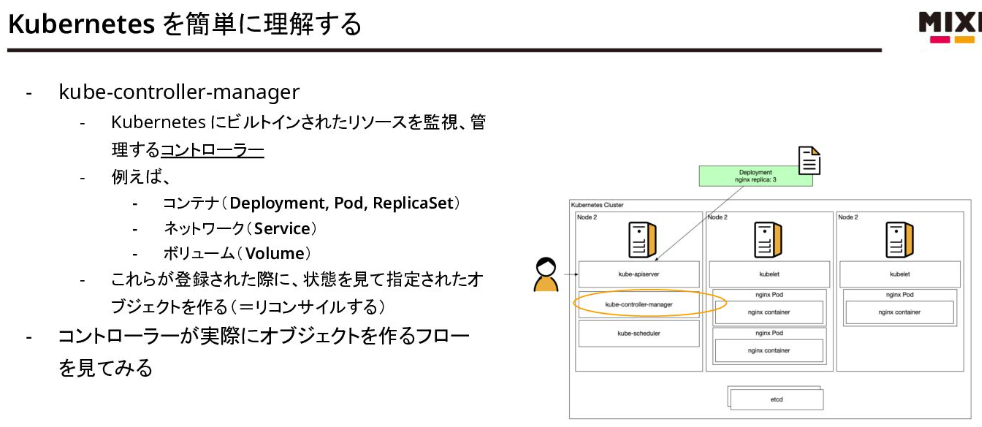

# コンテナ・K8s研修【MIXI 26新卒技術研修】 - Speaker Deck

- [コンテナ・K8s研修【MIXI 26新卒技術研修】 - Speaker Deck](https://speakerdeck.com/mixi_engineers/2026_new_grad_training_container)
- [コンテナ・K8s研修【MIXI 26新卒技術研修】 - Speaker Deck](https://speakerdeck.com/mixi_engineers/2026_new_grad_training_container_gke)
- day1
- 
  - OCI (Open Container Initiative)
  - コンテナ技術ではlinuxの namespace, cgroups 機能を使っている
    - macOSにはこれらの機能が無い
      - ので、Docker Desktopでは、Hypervisor Frameworkというものを利用して内部でLinuxを起動している
- day2
  - k8s
    - コンテナオーケストレーションツール
    - 使う理由
      - リソース管理を隠す
        - kube-schedulerを使ってコンテナを指定したノードに効率よく配置
      - 障害の自動復旧
      - 可用性（各種分散のしくみがあるため可用性が高い）
    - GKE (google kubernetes engine)
      - マネージドなk8s
      - 一部手動な箇所もある
- 
- 
- 
