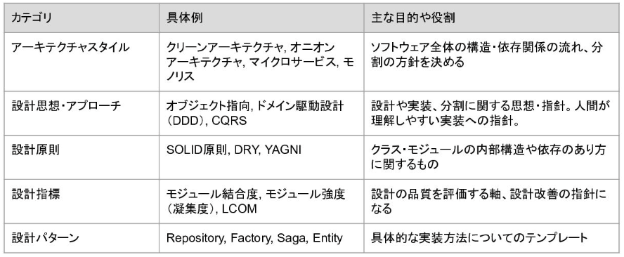

# ソフトウェアアーキテクチャ研修【MIXI 26新卒技術研修】 - Speaker Deck

- [ソフトウェアアーキテクチャ研修【MIXI 26新卒技術研修】 - Speaker Deck](https://speakerdeck.com/mixi_engineers/2026_new_grad_training_software_architecture)
  - 開発のパフォーマンスを計測するには？
    - for keys
      - リードタイム：コミットから本番反映までの時間
      - デプロイ頻度
      - 変更失敗率：リリース後に障害や修正が起きた割合
      - 平均修復時間（MTTR）：変更失敗時にサービス復元にかかる時間
  - アーキテクチャ
    - マクロレベル
      - モノリシックアーキテクチャ（モノリス）
      - マイクロサービス
        - せっかくマイクロサービスをしている以上、同期APIでマイクロサービス間の通信をするのは可用性の面でもったいない
          - なので、できるだけ非同期のメッセージで通信するのが良い
        - 複数サービス間の整合性は、Sagaなどを利用する必要があり、とても大変
          - 結果整合性という観点で担保する必要がある
            - 結果整合性：一時的には不整合なことがあっても、最終的には整合性が取れていること
        - マイクロサービス化の是非は（プロダクトの性質の他に）組織構造も関係してくる
        - 最初はモノリスで始めて、辛くなったら必要な箇所だけマイクロサービスに切り出す、ような手段をとるとよい
        - マイクロサービスだからといって必ずDBを同期する必要はなく、APIを叩いて別サービスから都度都度データを取得するやりかたもあり
      - モジュラーモノリス
        - コード上でさえしっかりと分離できていれば認知負荷は低減できるという思想のもと、1つのリポジトリでモジュール化を適切に行うことで分割すること
    - 疎結合を実現するための方法論
      - 
      - 参照系の機能をドメインモデルに則って作ると無駄に大変だったりするようなとき、CQRS の考えかたを採用して、参照系は（ドメインを無視して）直接参照するようなやりかたもあり
      - ドメインモデルの設計は、DBのテーブル設計に加えて、ドメインが持つルールを挙げていくような作業になる
