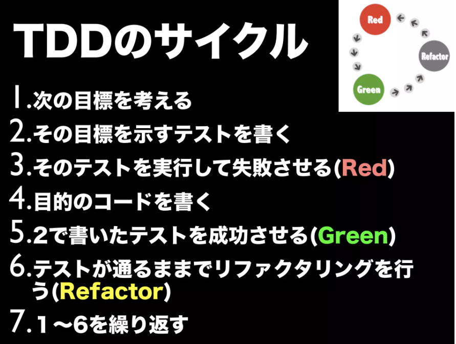
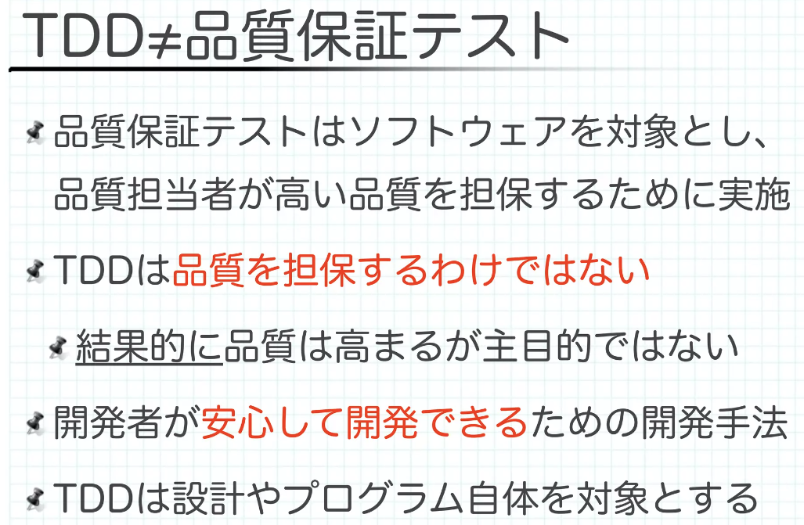

# テスト

- ステートメントカバレッジ
  - 命令を網羅
- ブランチカバレッジ
  - 分岐を網羅
    - 個々の分岐のT/Fを網羅する
- コンディションカバレッジ
  - 条件を網羅
    - 条件の組み合わせをすべて調べる
- ステートメントカバレッジ < ブランチカバレッジ < コンディションカバレッジ
- デシジョンテーブル
  - 条件（入力）に対して、どのようにソフトウェアが動作（出力）するのかを決定する表
  - [第5回　仕様整理に「デシジョンテーブル」を使ってみよう | gihyo.jp](https://gihyo.jp/dev/serial/01/test_up/0005)
    - >デシジョンテーブルでは、基本として、まず、「⁠条件」の部分に「Y」と「N」の組み合わせをすべて書き出します。
    - 「あり得ない組み合わせ」の場合、結果には「N/A」を書き込む
  - [デシジョンテーブルテストでの簡単化について｜Tsuyoshi Yumoto｜note](https://note.com/yumotsuyo/n/n7fd169368233)
    - >デシジョンテーブルは、次の列を削除することで縮小することができます。
      - > 不可能な条件の組み合わせを含む列
      - > 可能ではあるが現実的ではない条件の組み合わせを含む列
      - > 結果に影響しない条件の組み合わせをテストする列
  - 仕様を整理したり確認したりするためのツール
- テスト駆動開発
  - [DO03 50 分でわかるテスト駆動開発](https://www.slideshare.net/decode2017/do03-50)
    - 「動作するきれいなコード」がゴール
    - 
  - [テスト駆動開発へようこそ](https://www.slideshare.net/shuji_w6e/ss-30692945)
    - 短いサイクルの繰り返しが大事
    - 
- ロジックに条件Aと条件Bがあり、網羅すると`条件数 ^ 2`通りのテストが必要になりそうなときの解決策
  - `全て正常系, Aの異常系, Bの異常系, Bの異常系`のように分ける
    - `条件数 + 1`通りで済む
  - 各条件を制御する値を、factoryでランダム化にして、`Aのtrue, Aのfalse, Bのtrue, Bのfalse, ...` のように列挙する
    - `条件数 * 2`通りで済む
