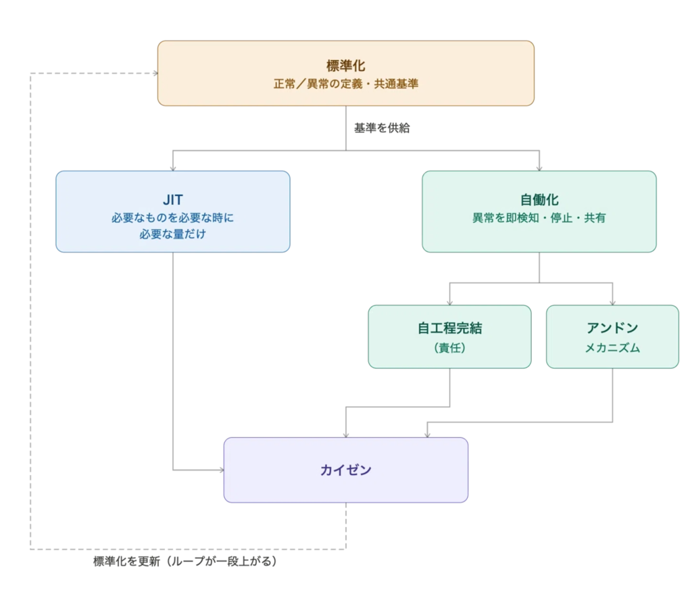

# トヨタ生産方式

- TPS (Toyota Production System) というらしい
  - [自働化、カイゼン、標準化ーー組織のAI活用を3倍にする製造業の知恵 - Sansan Tech Blog](https://buildersbox.corp-sansan.com/entry/2026/04/21/100000)
    - >自働化がハーネスエンジニアリングと驚くほど重なる
- []
