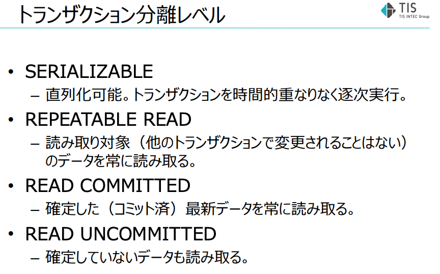
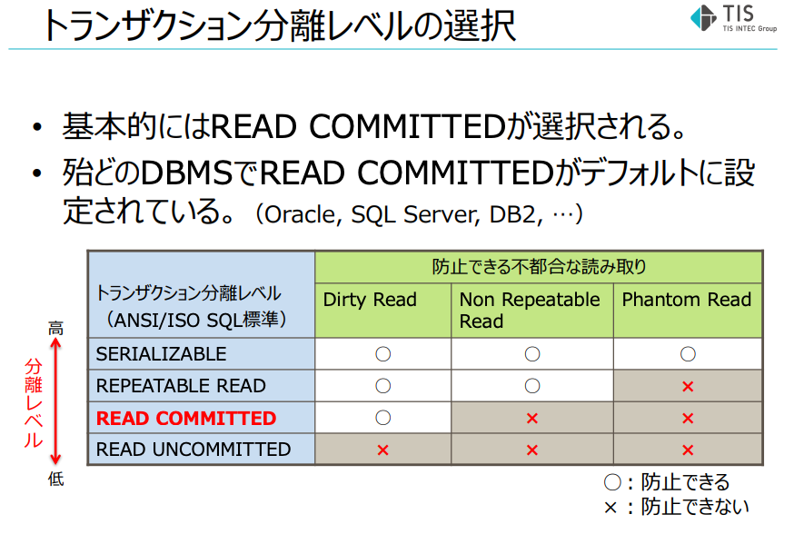
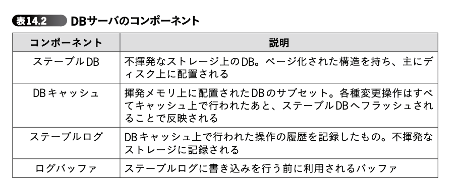
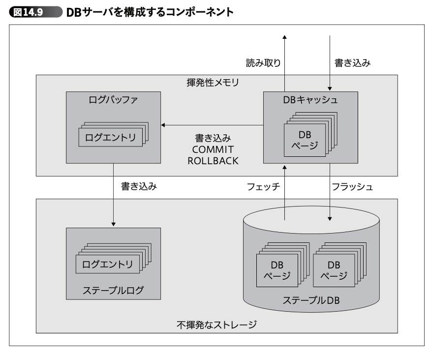

# トランザクション分離レベル

- [データベースの排他制御](https://fintan.jp/wp-content/uploads/2022/03/Database-Exclusion-Control.pdf) のトランザクション分離レベルの章
  - > トランザクションを同時実行したときの独立性を決定するレベル
  - > 分離レベルが高いほど色々な不都合な読み取りを防ぐことができるが、スループットは低下する
  - 
  - Dirty Read
    - 他トランザクションで更新しているコミット前のデータを読み出してしまう。
      - >誤った値で処理が行われる可能性がある為、絶対に避けなければなりません。
  - Non Repeatable Read
    - あるトランザクションで同じ行を２回読み込んだ際、１回目と２回目のデータが異なってしまう
  - Phantom Read
    - あるトランザクションにおいて、1回目と2回目の処理でレコード件数が異なってしまう
- トランザクション分離レベルの選択
  - → **基本的にはREAD COMMITTEDが選択される。** (  も)
  - 
  - READ COMMITTED
    - 検索時点でコミット済のデータのみを参照する。
- 「理論から学ぶデータベース実践入門」14章「トランザクションの本質」
  -   - DBサーバのコンポーネント
    - >トランザクション理論では、DB サーバは表 14.2 のコンポーネントで構 成されているとされています
    - 
      - ステーブルログは、いわば直列化されたトランザクションのスケジュール
        - >テーブルログに記録されているログエントリを再生(REDO)することで、DB キャッシュを最新の状態まで復元します
        - >その後、クラッシュする瞬間にまだ完了していなかったトランザクショ ンによる更新を取り消し(UNDO)ます。REDO と UNDO の両方を実行し て初めてクラッシュリカバリが完了することになります
    - 
- [トランザクション分離レベルについてのまとめ  - Qiita](https://qiita.com/song_ss/items/38e514b05e9dabae3bdb#read-committed)
  - > まとめ
    - > トランザクションは1つの作業単位として扱う一連の操作の集まり
    - > トランザクション分離レベルはACID特性のI(Isolation、分離性)に関する概念で、他のトランザクションに影響を与えるレベルを意味する
  - > READ UNCOMMITTED：コミットされていない変更を他のトランザクションから参照できる
    - > ダーティリード、ファジーリード、ファントムリードが全て発生する
  - > READ COMMITTED：コミットされた変更を他のトランザクションから参照できる
    - > Oracle、PostgreSQL、SQL Serverのデフォルトのトランザクション分離レベル
    - > ファジーリード、ファントムリードが発生する
  - > REPEATABLE READ：コミットされた追加・削除を他のトランザクションから参照できる
    - > MySQLのデフォルトのトランザクション分離レベル
    - > ファントムリードが発生する
    - > MySQL(InnoDB)はREPEATABLE READでもファントムリードが発生しない
  - > SERIALIZABLE：強制的にトランザクションを順序付けて処理する(直列化)
    - > 読み取るすべての行に共有ロックをかける
    - > ダーティリード、ファジーリード、ファントムリードが全て発生しない
