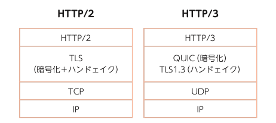

# ネットワークセキュリティ

## 暗号と認証のしくみと理論がこれ1冊でしっかりわかる教科書

- [図解即戦力 暗号と認証のしくみと理論がこれ1冊でしっかりわかる教科書：書籍案内｜技術評論社](https://gihyo.jp/book/2021/978-4-297-12307-9)

- **8章 ネットワーク セキュリティ**
- **40 DNS**
  - ルートネームサーバーから名前解決をするのが教科書的だけれども、普通はDNSキャッシュサーバーを間に挟んでいる
  - DNSはUDP
    - 「キャッシュ・ポイズニング攻撃」
      - キャッシュサーバーに誤った対応を登録させる攻撃
  - 「DNSSEC (DNS SECurity extensions)」
    - 権威DNSサーバーが署名付きのデータを返すように
    - キャッシュDNSサーバー↔権威DNSサーバー間の完全性を保証
  - 「パブリックDNSサーバー」
    - GoogleやCloudflareが提供しているDNSサーバー
  - 「DoT (DNS over TLS)」「DoH (DNS over HTTPS)」
    - クライアント↔キャッシュDNSサーバー間の機密性と完全性を保証
  - 「SNI (Server Name Indication)」
    - 一台のサーバーで複数のドメインを管理するとき、TLSのClienthelloの中にアクセスしたいドメインを指定するTLSの拡張
      - VPS, レンタルサーバーとかが使う
    - SNIに暗号化したを加えた規格もある
- **41 メール**
  - 「SMTP (Simple Mail Transfer Protocol)」
    - メールの転送方法
  - 「[POP3](Post Office Protocol version 3)」
    - メールサーバからメールを取り出す方法
    - 取り出したらそのメールはメールサーバーから削除
      - pop?
  - 「IMAP4 (Internet Message Access Protocol version 4)」
    - メールサーバーから取り出すだけ。POP3とは違って取り出し後も消さない
  - 「多目的インターネットメール拡張 MIME (Multipurpose Internet Mail Extension)」
    - メールの拡張
  - 「S/MIME (Secure MIME)」
    - MIMEに秘匿性と完全性を追加
    - 送信者のクライアントから受信者のクライアントまで暗号化
      - E2E (End-to-End)な暗号化
    - 受信側が送信側の公開鍵を入手しておく必要がある
    - あまり普及していない
  - 「Webメール」
    - Gmailとか
    - webサービスとしてのメール
- **42 VPN**
  - インターネット標準であるRFC1122の、リンク層で指定されている規格
    - 有線ではイーサネット(Ethernet)
    - 無線ではIEEE 802.11
  - LANについて
    - LAN内の通信はイーサネットフレームでやりとり
    - LAN内の機器と外部との通信はルーターを経由
      - インターネットサービスプロバイダのインターネット回線を通る
  - 「VPN」
    - ネットワーク↔ネットワーク間を拠点間VPN
    - PC↔ネットワーク間をリモートアクセスVPN
    - 「トンネリング」
      - VPNゲートウェイ間で、送受信データがそのまま送受信されたかのように見せる仕組み
      - 「カプセル化」
        - トンネリングをするにあたってデータの暗号化などをする
    - レイヤ2 VPN
      - イーサネットフレームをトンネリング
      - OSI参照モデルでいうレイヤ2のことだと思う
    - レイヤ3 VPN
      - IPパケットをトンネリング
    - SSL-VPN
      - TLSを通してトンネリング
      - イーサネットフレームをトンネリングすればレイヤ2 VPNとして使える
    - IPsec
      - レイヤ3 VPNで使う
      - IPパケットに秘匿性と完全性を加える
- **43 HTTP/3**
  - 「SPDY (スピーディー)」
    - Googleが2012年にSPDYを制定
      - 高速なHTTP
  - 「HTTP/2」
    - IETFが2015年にSPDYを「HTTP/2」として標準化
    - 新機能
      - ストリームの多重化
      - バイナリベース
    - なお残る問題点
      - HOLブロッキング (Head-Of-Line blocking)
        - TCPレイヤーで不具合があると、そのパケットの再送までストリーム全体が止まる
      - TLSとTCPの2重管理問題
        - (TLSの復習) [Transport Layer Security - Wikipedia](https://ja.wikipedia.org/wiki/Transport_Layer_Security)
          - インターネット・プロトコル・スイート
            - = TPC/IP参照モデル
            - OSI参照モデル(7層)とは別なので注意
            - アプリケーション層(HTTP, HTTPS, POP, SMTP, SSH, NTP, ...)↔トランスポート層(TCP, UDP)↔インターネット層(IP)↔リンク層
          - トランスポート層↔アプリケーション層間の通信について規定
          - 認証、暗号化、完全性付与の機能
            - セキュリティのため
          - ClientHello, ServerHello, ClientKeyExchangeとかをするやつ
          - トランスポート層には必ずしもTCPを使わなくてもいい
          - アプリケーション層には何を使ってもOK
            - HTTPを使った場合、HTTP + TLS = HTTPS となる
        - (TCPの復習)
          - エラー訂正機能
            - 通信自体の故障に対応するため
          - SYN, SYN/ACK, ACK とかの3-wayハンドシェイクとかはこっち
        - TCPでTLSをすると、データ順序の保証機能、通信終了の確認機能、輻輳制御機能などが被るため非効率
  - 「QUIC」
    - Googleが提案
    - UDPを利用
    - 「Connection ID」を用いてHOLブロッキングを解消
    - エラー訂正の処理はQUICが担うので無駄がない
    - QUICの処理はアプリケーションで行う
      - TCPでは処理はOSの役目だった
    - 「コネクションマイグレーション」機能
      - IPアドレスやポート番号に依存しないので、切替時に通信が途絶えない
  - 「HTTP/3」
    - HTTP/QUICがHTTP/3となった
    - 2018に制定
    - TLSはハンドシェイクに専念
- 
- **44 無線LAN**
  - TCP/IP参照モデルのリンク層での話
  - IEEE 802.11で規定
    - a/b/g/n/ac/axとかは、IEEE 802.11のどのバージョンかを示している
    - 現在の最新はIEEE 802.11ax
  - Wi-Fi
    - 無線LAN機器間で相互接続の保証を示すWi-Fi Allianceの登録商標
  - アクセスポイントが、無線LANのIEEE 802.11フレームと有線LANのイーサネットフレー ムを相互変換する
    - 通常、ルーターがアクセスポイント機能も担う
    - 「SSID (Service Set IDentifier)」
      - アクセスポイントのID
  - 「WEP (Wired Equivalent Privacy)」
    - 無線LANの最初の暗号化方式
    - 脆弱性有り
  - 「WPA2 (Wi-Fi Protected Access 2)」
    - 広く使われている
  - 「WPA3」
    - 2018に制定
