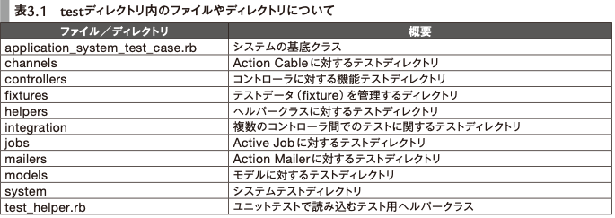
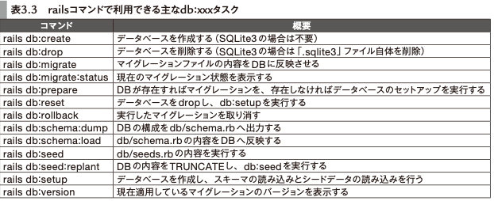

# パーフェクトRuby on Rails

- Ruby on Rails
- [パーフェクトRuby on Rails【増補改訂版】：書籍案内｜技術評論社](https://gihyo.jp/book/2020/978-4-297-11462-6)
- **1章 Ruby on Railsの概要**
- **1-1 Railsを使う前に**
  - `rails _5.2.3_ -v`のようにバージョンを指定してrailsを使える
- **1-2 Railsの思想**
  - 思想
    - CoC (Convention over Configuration)
    - DRY
    - REST
    - 自動テスト
- **1-3 Railsをはじめよう!!**
  - binに入っているコマンドはbinstubという
  - libディレクトリは、かつてはアプリのライブラリ置き場だった
    - 今はここにファイルを置くのは非推奨で、app配下に置くのが推奨
- **1-4 scaffoldを使ってRailsでの開発を体験しよう**
- **2章 Ruby on RailsとMVC**
- **2-1 MVCアーキテクチャ**
- **2-2 モデルを扱う**
  - scopeでnilを返すと空の`ActiveRecord::Relation`になって返る
- []
- []
  - `after_initialize`, `after_find` というのもある
  - 列挙型には`ActiveRecord::Enum`
    - statusに対して`!`や`?`のメソッドが生える
    - `カラム名_before_type_cast`で、DB内の実際の値を取れる
    - status名がそのままscopeになる機能もある
      - `not_status名`も生える
- **2-3 コントローラの役割**
  - >Railsでは通常、GET以外のリクエストではセキュリティトークンが必須
    - CSRF対策
  - ルーティングのresoucesの内側で独自のGETやPOSTのルーティングをするとき
    - [Rails のルーティング - Railsガイド](https://railsguides.jp/routing.html#%E3%83%A1%E3%83%B3%E3%83%90%E3%83%BC%E3%83%AB%E3%83%BC%E3%83%86%E3%82%A3%E3%83%B3%E3%82%B0%E3%82%92%E8%BF%BD%E5%8A%A0%E3%81%99%E3%82%8B)
    - そのまま書くと
      - idを見るときは`params[:photo_id]`のようになる
    - `member do`内に書くと
      - idを見るときは`params[:id]`を使える
      - resoucesの一種の扱いに近くなる
  - 例外は、基本的には500になって返る
    - 例外クラスによってはRails側がいいかんじのステータスコードにしてくれる
- []
- **2-4 コントローラとビューの協調とビューテンプレートの基本**
  - `request.variant`機能で、たとえばPCとスマホのページを出し分けられる
    - テンプレートファイルの探索が変化する
- **2-5 ビューテンプレートについて**
  - テンプレートエンジンいろいろ
    - HTML
      - ERB
      - Haml
      - Slim
    - API
      - jbuilder
  - jbuilder
    - `!`で終わらないメソッドは、メソッド名がそのままjsonのキーになる
      - 引数が値になる
      - 引数の値がArray系だと、メソッドに渡されたブロックで要素をeachする
    - `!`で終わるメソッドには特殊な機能がある
- **3章 押さえておきたいRailsの基本機能**
- **3-1 テストの種類と実行方法**
- 
  - ↑ minitestの場合
  - minitestのassert
    - `assert_output(stdout = nil, stddrr = nil) {}`
      - ブロック内でのstdout(err)への書き込みの引数との一致
- **3-2 RackとRailsの関係**
  - Puma, Unicorn ↔ Rack ↔ Rails, Sinatra
  - Rackに乗るには `call(env) # -> [status, headers, body]`
    - `env`にはHTTPリクエストの情報
  - ミドルウェアを使うには、config.ru内で`use ミドルウェア名`
  - [rack/rack-contrib: Contributed Rack Middleware and Utilities](https://github.com/rack/rack-contrib)
    - Rackミドルウェアを集めたリポジトリ
  - `rails middleware`
- **3-3 DBを管理する**
- 
  - >（db/seeds.rbでの）データ投入の際は、「!」付きのメソッドを利用するなどして、エラー発生にすぐ気がつける ようなコードにしておくと良いでしょう。
  - 複数DB
    - 5までは
      - `Octopus`, `switch_point`
    - 6から
      - 標準で、以下の機能をサポート
      - >・ 複数の「primary」データベースと、それぞれに対応する1 つの「replica」
      - >・ モデルでのコネクション自動切り替え
      - >・ HTTP verbや直近の書き込みに応じたprimaryとreplicaの自動スワップ
      - >・ マルチプルデータベースの作成、削除、マイグレーション、やりとりを行うRailsタスク
  - 使い方
    - モデルごとにDBを分けるとき
      - database.ymlにprimaryとsubの2つを定義
      - モデルの`rails g`時に`--database=sub`を指定
      - `establish_connection :sub`でsubの方へアクセス
    - write/readで分けるとき
      - database.ymlで、レプリカの方には`replica: true`と指定
      - DBのユーザーのgrantも参照のみしておくとよい
      - `connect_to`でwrite/read時のDBを指定
- **3-4 秘密情報を管理する**
  - 歴史
    - そもそも、`secret_key_base: "xxxxxxxxxxxx"`の値を使ってCookieとかに使うための秘密の値を生成する、というRailsの取り決めがあった
    - ~ 4.0
      - `config/initializers/secret_token.rb` に平文保存
      - [The Twelve-Factor App](https://12factor.net/ja/) の影響を受けて、環境変数経由が一般的に
        - dotenv, figaro などを使うようになった
        - 環境変数に保存する値の管理には、もっと厳重に権限管理されたリポジトリを使う
    - 4.1
      - `config/secrets.yml`の登場
      - 置き場所ができた
      - 環境変数経由なのはそのまま
    - 5.1
      - encrypted secretsによる暗号化
      - `config/secrets.yml.enc` に暗号化した内容を記載
      - 復号化のキーのみを環境変数で渡し、厳重に管理する
      - `secrets.yml.enc`はコマンド経由で編集
    - 5.2
      - credentialsが登場
      - 管理が煩雑であった問題を解消
      - 3つの要素
        - `config/credentials.yml.enc`
          - 暗号化した設定ファイル
        - `config/master.key`
          - Git管理しないファイル
          - 開発環境ではこのファイルに直接書き込む？
        - `RAILS_MASTER_KEY`
          - `master.key`の値を環境変数経由で受け渡す場合の環境変数名
          - 本番環境ではこの環境変数を使って立ち上げる？
      - `rails credentials:edit`で編集
      - `Rails.application.credentials.xxx`や`railscredentials:show`で参照
    - 6.0
      - credentialsの拡張
      - ステージングでは本番とは別の秘密の値を使いたい、というニーズに対応
      - `rails credentials:edit --environment staging`のようにする
      - Railsは`RAILS_ENV`を見て、`credentials/{RAILS_ENV}.yml.enc`か`credentials.yml.enc`のどちらか一方を読み込む
- **3-5 HTTPとRailsアプリケーション**
  - 「Early Hints」
    - HTTPのpreloadよりも早く
      - preloadはパース時間の短縮には一役買うけれども、一度目のレスポンス自体の時間の短縮にはならない
    - 103 Early Hintsで、メインのレスポンス前にpreloadしてほしいURLを返すことができる
    - 実際にはEarly Hintsは未実装のブラウザが多く、リバースプロキシを使ってHTTP2のサーバープッシュの機能で代替するのが現実的
      - サーバープッシュとは、クライアントの要求を予想して、その要求が来るのを待たずにレスポンスを送る技術
    - リバースプロキシサーバー用ライブラリ `h2o`
  - 「Content Security Policy(CSP)」
    - Content-Security-Policy ヘッダーで指定することで、外部ドメインのリソースを無効化
    - `config/initializers/content_security_policy.rb` にCSPの設定を書く
    - nonceの利用
      - インラインjsはscriptタグのnonce属性が一致するもののみ実行可にする、という制限
- **4章 フロントエンドの開発手法**
- **4-1 Webpackerを使ってJavaScriptを管理する**
  - Webpacker
    - webpackをRailsから使いやすくしたもの
    - Rails6のデフォルト
      - パッケージマネージャはyarn
      - 6より前は[Sprokets](Rails独自)
  - webpack
    - ファイルをまとめる(モジュールバンドラー)
    - コンパイル(トランスパイル)をする
      - jsだけじゃなくてSassとかも
    - 圧縮をする
    - `webpack.config.js`
    - `babel`とかはwebpackへ追加する形で使う
  - CSSや画像は従来通りSprocketsで管理する (RailsのViewを使う場合)
    - Webpackerで扱うことも可
      - `app/javascript/stylesheets/application.css`は`require("stylesheets/application")`で読み込む
      - `stylesheet_pack_tag`でCSSを読み込む
      - 画像は`image_pack_tag`
  - webpackによる開発
    - `app/javascript`に書いたjsが`public/packs/js`に吐かれる
    - `javascript_pack_tag`でwebpackで作ったjsを読み込んでいる
      - sprockets時代は`javascript_include_tag`
  - Webpackerでラップしたwebpackを使っているときは、`webpack.config.js`ではなく`config/webpacker.yml`を使って設定を管理する
  - `rails assets:precompile`をすると、Sprocketsのプリコンパイルとwebpackのビルドの両方が実行される
    - Sprocketsからのスムーズな移行のために一つのコマンドになっている
  - webpack-dev-server
    - `bin/webpack-dev-server`で起動
    - webpack管理下のファイルの更新を検知し、ビルド
    - 開発環境下では、起動していてもしていなくてもjsファイルのリクエストは通り、これは`Webpacker::DevServerProxy`Rackミドルウェアのおかげ
  - webpackのloaderやpluginを、Webpackerの仕組みで追加できる
- **4-2 SprocketsによるCSSの管理**
  - Sprockets
    - CSSのコンパイル
    - `RAILS_ENV=production`で`rails assets:precompile`すると、圧縮されたCSSがpublic/assets以下に作られる
      - これはnginx等のHTTPサーバーで配信するもよし、CDNで配信するもよし、Railsで配信するもよし
        - Railsで配信するなら環境変数経由で設定する`config.public_file_server.enabled = ENV['RAILS_SERVE_STATIC_FILES'].present?`
- **4-3 Railsに組み込まれているJavaScriptの機能**
- (省略)
- **4-4 控えめなJavaScriptフレームワークStimulus**
- (省略)
- **5章 Rails標準の機能を活用して素早く機能実装する**
- **5-1 Active Jobによる非同期実行**
  - `rails g job async_log`で`app/jobs/async_log_job.rb`が作られる
  - ジョブクラスはApplicationJobを継承する
  - `perform_later`でenqueue
    - `AsyncLogJob.set(wait: 1.minute).perform_later`のように、時間の指定もできる
  - `perform_later`の引数にActiveRecordオブジェクトを渡すと、`peform`時にはその時点でDBからfetchしたレコードのデータが使われる
    - レコードの実体ではなく`gid://active-job-example/AsyncLog/3`のようなURIを渡している
  - バックエンドとジョブをつなぐアダプター
    - デフォルトでは async アダプター
      - 本番環境には不向き
    - Sidekiq, Resque, Delayed Job など
      - Shoryukenは、AWS SQSをqueueとして利用するとき用のgem
    - (sidekiqなら)`bundle exec sidekiq`でプロセスを起動する
  - queueはJobごとにあるのではない。自由。
    - デフォルトでは`default`queueを使う
    - 別のqueueを使いたい場合
    - 1. `config/sidekiq.yml`に設定を書く
    - 2. Jobクラス内で`queue_as :async_log`のようにqueueを指定する
    - 2. `set`メソッドで動的に指定する
  - `retry_on`でリトライできる
  - `discard_on`で、例外次第でリトライを中断できる
  - テスト
    - `ActiveJob::TestCase`を継承したクラスで、`assert_enqueued_with`アサーションでテストする
- **5-2 Active Storageによるファイルアップロード**
  - Active Storage
    - Rails 5.2から
    - 標準機能でファイルアップロードができるようになった
  - 始め方
    - `rails active_storage:install`
    - `rails g scaffold user name portrait:attachment`
      - `portrait`属性は別のテーブルで管理される
- 
  - ファイル置き場の指定は`config/storage.yml`に書く
    - 開発環境ならローカルのファイルシステム
    - 本番ならAWS S3
    - 環境ごとの振り分けは`config/environments/development.rb`等で`config.active_storage.service = :local`のように設定する
  - サムネイル機能もActive Storageに備わっている
- **5-3 Action Mailerによるメール送信**
  - `rails g mailer UserMailer`
  - ` UserMailer.with(to: "rails@example.com", name: "rails").welcome.deliver_now`のように呼ぶ
  - 開発環境でメールの動作確認
    - `config.action_mailer.delivery_method = :file`と設定
      - 実際に送信はされず、`tmp/mails`以下に保存される
  - テスト環境で動作確認
    - `config.action_mailer.delivery_method = :test`
      - 実際に送信はされず、`ActionMailer::Base.deliveries`配列にメールが入る
  - 本番
    - 送信のためのSMTPサーバを用意する必要がある
      - SendGridなど
        - SendGridで作ったアカウントをcredentialsとして保存して、`config.action_mailer.smtp_settings`で設定する
- **5-4 Action Mailboxによるメール受信**
  - メールサーバーサービス(SendGridなど)と連携できる
    - SendGridにRailsアプリのURLを叩いてもらうことで、メールの受信をする
    - メールサーバーがrailsコマンドを叩くことで連携する場合もある
  - 受信したらAction MailBoxが処理をする
  - `bin/rails action_mailbox:install`
  - 外部からのリクエストを認証する設定を書く
  - SendGridにメールが届くように、DNSのMXレコードを設定する必要がある
  - RailsのURLが叩かれたとき
    - InboundEmailモデルが作られる
      - メールの処理状態を管理するモデル
      - 
    - メールをActive Storageで保存
    - Active Jobで処理をenqueue
    - メールサービスにレスポンスを返す
  - app/mailboxes/application_mailbox.rb
    - `routing (/[0-9]+-comment@/i) => :comments`
  - `bin/rails generate mailbox comments`
    - ApplicationMailboxを継承した、`#process`が生えたクラスが作られる
  - 開発時は`/rails/conductor/action_mailbox/inbound_emails`でRailsにメールを送れる
  - テスト
    - `receive_inbound_email_from_mail`
      - InboundEmailが作られ、それを受信したことになる
- **5-5 Action Textによるリッチテキスト機能**
- (省略)
  - フロントはTrixというライブラリを使っている
- **5-6 Action Cableによるリアルタイム通信**
  - WebSocketを使ったリアルタイム双方向通信
  - `bin/rails g channel room speak`
    - 以下が作られる
**app/channels/room_channel.rb**

```
class RoomChannel < ApplicationCable::Channel
  # 購読後に呼ばれる
  def subscribed
     stream_from "room_channel" # "room_channel" という名前のブロードキャストを設定
  end

  # 購読解除後に呼ばれる 
  def unsubscribed
  end

  # クライアントから呼び出された時に実行される
  def speak(data)
    # ストリーム名 "room_channel" で通信しているクライアントすべてに届いたメッセージを送信
    ActionCable.server.broadcast("room_channel", { message: data["message"] })
  end
end
```

**app/javascript/channels/room_channel.js**

```
consumer.subscriptions.create("RoomChannel", {
  // 接続時. input要素などにspeakを呼び出すイベントを登録
  connected() {
  },

  // 切断時
  disconnected() {
  },

  // サーバからのデータを受信した時
  received(data) {
    alert(data['message']);
  },

  speak: function() {
    return this.perform('speak'); // RoomChannel#speak メソッドを WebSocket 通信経由で呼び出す
  }
}
```

- 上記の実装をすると、ブラウザ側でspeakメソッドを`speak("hoge")`のように呼び出すと、サーバー側ではそれを山びこするので、ブラウザでは`received(data)`の`alert("hoge")`が呼ばれる
- 接続を管理するアダプタが必要
  - デフォルトだと[Redis](本番環境)
    - 開発環境はインメモリ
- (アプリサーバーとしてのRailsと分離させて、) Action Cable専用のプロセスを建てることもできる
  - config.ruで`run ActionCable.server`する
  - `bundle exec puma cable/config.ru`で起動
  - 別ドメインにする
    - `config.action_cable.url = "wss://example.com/cable"`
  - app/views/ layouts/application.html.erbには`action_cable_meta_tag`を書く
  - `config.action_cable.allowed_request_origins`にその別ドメインを追記
- Action Cableの認証
  - 署名付きCookieにUserのidとかを入れる(APIサーバー側)
  - `Connection < ActionCable::Connection::Base`を編集する
    - WebSocket 接続時にインスタンスが作成されるクラス
    - `identified_by :current_user`とする
      - `current_user`フィールドが作られる
    - クライアントが接続した時に呼ばれる `connect`メソッドに、current_userにユーザーを代入する処理を書く
- **6章 Railsアプリケーション開発**
- **6-1 イベント告知アプリケーションを作る**
  - railsデフォルトのwebサーバーはpuma
- **6-2 アプリケーションの作成と下準備**
- **6-3 OAuthを利用して「GitHubでログイン」機能を作る**
  - github上でアプリの登録が必要
    - Developer settings → OAuth Apps → New OAuth App
    - 
  - OmniAuth gem
    - ユーザ認証機能を提供するgem
      - 「どのような形式で認証するか」は OmniAuth とは別に実装できる
        - どのような形式で、ってどういうことだろう?
    - CSRF対策が必要
      - 「悪意のあるサイトのjsが、作ったアプリのOAuthリンクを勝手に踏んで、勝手にOAuthで認証認可してしまう」ということ?
      - https://github.com/cookpad/omniauth-rails_csrf_protection gemで対策できるらしい
  - Githubで得たClient IDとClient Secretをアプリに設定する
```rb
Rails.application.config.middleware.use OmniAuth::Builder do
  if Rails.env.development? ¦¦ Rails.env.test?
    provider :github,
      "YOUR_CLIENT_ID",
      "YOUR_CLIENT_SECRET"
  else
    provider :github,
      Rails.application.credentials.github[:client_id],
      Rails.application.credentials.github[:client_secret]
  end
end
```

- `config/credentials.yml.enc`復号化用のキーは、`config/master.key`(git管理しないファイル)か`RAILS_MASTER_KEY`を使って設定する
- ユーザーが`/auth/github`のリンクを踏む → OmniOuthによってgithubのOAuth用ページへリダイレクトされる。という流れ
  - OmniOuthが、Githubにログイン済みか未ログインかを判定してくれて、未ログインならリダイレクトしてくれる
- ユーザーがgithubの認証画面でAuthorizeしたあとの、アプリ側での処理
  - OmniAUthのコールバックURLは、デフォルトでは`auth/:provider/callback`
    - `get "/auth/:provider/callback" => "sessions#create"`とする
  - `SessionsController#create`を実装していく
    - ログインorユーザー登録の処理
    - `request.env["omniauth.auth"]`で`OmniAuth::AuthHash`オブジェクトが得れる
      - `auth_hash[:provider]`
      - `auth_hash[:uid]`
      - `auth_hash[:info]`
    - `provider, uid`でUserを見つけて、UserのidをCookieに入れてログインとする
- ログアウト
  - `delete "/logout" => "sessions#destroy"`
  - `SessionsController#destroy`
    - セッション(Cookie)を消せばOK
- **6-4 イベントの登録機能を作る**
  - config/application.rbで`config.time_zone = "Tokyo"`
    - アプリで扱う値は日本時間になる
  - DBに入る値もJSTにしたいときは
    - `config.active_record.default_timezone = :local `
    - プリケーションサーバのタイムゾーンを JST にする
  - `Time`, `DateTime` ではなく `ActiveSupport::TimeWithZone`を使うべし
    - `Time.zone.now`, `Time.current` で得れる
    - ActiveSupport::TimeWithZone
  - SJR
    - Server-generated JavaScript Responses
    - `.js.erb`みたいなやつ
- **6-5 イベントの閲覧機能を作る**
  - `localize`メソッド
    - i18nで日時を文字に変換
  - `User.id = Event.owner_id`と`User.id = Event.organizer_id`のように、同一モデル間に複数の関連付けがある場合も想定して、`has_many :created_events, class_name: "Event", foreign_key: "owner_id"`のようにするのがよい
- **6-6 イベントの編集・削除機能を作る**
- **6-7 登録されたイベントへの参加機能，参加キャンセル機能を作る**
- **6-8 退会機能を作る**
- **6-9 おわりに**
- **7章 Railsアプリケーションのテスト**
- **7-1 テストコードをどう書いていくか**
- **7-2 minitestとRSpec**
  - minitest
    - xUnit風な書き方とRSpec風な書き方の2 通りをサポート
    - Rails標準
    - `bin/rails generate test_unit:scaffold ticket [--api]`で、scaffold後に後からテストを追加できる
  - RSPec
    - テストを構造化しやすい
    - メジャー
- **7-3 テストデータを作成する**
  - `bin/rails g factory_bot:model user`
  - `factory`メソッドには`alias:`キーワード引数がある
- **7-4 システムテスト**
- **7-5 コントローラに対する機能テスト**
  - コントローラに対する機能テストはビューもrack middlewareも実行する
**test/sign_in_helper.rb**

```
module SignInHelper
  def sign_in_as(user)
    OmniAuth.config.test_mode = true
    OmniAuth.config.add_mock(
      user.provider,
      uid: user.uid,
      info: { nickname: user.name,
      image: user.image_url }
    )
    case
    when respond_to?(:visit) # システムテストと機能テストの場合で処理を分岐
      visit root_url
      click_on "GitHubでログイン"
    when respond_to?(:get)
      get "/auth/github/callback"
    else
      raise NotImplementedError.new
    end
  @current_user = user
end

```

- **7-6 モデルに対するテスト**
  - ダブル
    - オブジェクトの代 わりをするオブジェクト
  - スタブ
    - ダブルの一種
    - `require 'minitest/mock'`
    - `user.stub(:id, event.owner_id)`
    - 未定義のメソッドに大してスタブはできないので注意
      - オブジェクトに定義済みのメソッドを差し替えることしかできない
  - モック
    - ダブルの一種
    - メソッドの戻り値を変えられる
    - `require 'minitest/mock'`
    - `user = MiniTest::Mock.new.expect(:id, event.owner_id)`
      - `user.verify`で呼ばれたことを検証
  - バリデーションなど、Railsの機能をテストしているようなことになりかねないときは、そのテストは書かないのもあり
- **8章 Railsアプリケーション拡張**
- **8-1 ファイルアップロード機能を作る**
  - `bin/rails active_storage:install`
  - `has_one_attached :image`
  - サムネイル生成
    - image_processing gem
      - ImageMagick, GraphicsMagick, libvips のラッパー
      - Rails 6.0のデフォルトはImageMagick
      - `config.active_storage.variant_processor = :vips`
    - `image.variant(resize_to_fit: [200, 200])`のようにすることで、アクセス時にサムネイルが生成されて、保存までされる
  - バリデーション
    - Active Storage Validations gemを使う
    - `validates :image, content_type: [:png, :jpg, :jpeg]`
      - ファイルタイプのバリデーション
      - 拡張子以外にファイルの中身まで見てくれる
    - `validates :image, size: { less_than_or_equal_to: 10.megabytes }`
      - サイズのバリデーション
    - `validates :image, dimension: { width: { max: 2000 } , height: { max: 2000 } }`
      - 大きさのバリデーション
  - アップロードされたかどうかの判定は `image.blob&.persisted?`
  - Active Storageにダイレクトアップロード機能はあるけれど、バリデーションが難しい
- **8-2 gemで機能拡張をする**
  - kaminariでページネーション
    - `bin/rails g kaminari:views bootstrap4`で、kaminariデフォルトのビューを上書きできる
  - Searchkick
    - Elasticsearchとデータベースを連携させるためのgem
    - Elasticsearchとは
      - 全文検索エンジン
      - >Elasticsearch は Elastic 社が中心となって開発を進めています。
      - >ElasticsearchをRubyで扱うためのgemであるelasticsearch gemは、Elastic社のリポジトリで管理されており、Elasticsearch の開発が続く限りメンテナンスが滞る心配はなさそうです。
      - Railsとは別プロセスで動く
      - `brew tap elastic/tap && brew install elastic/tap/elasticsearch-full`
      - `elasticsearch-plugin install analysis-kuromoji`
        - 形態素解析ライブラリ
    - モデルクラスにて
      - `searchkick language: "japanese"`
      - `def search_data`
        - elasticsearchのインデックスに追加する情報を登録する
    - `bin/rails r Event.reindex`コマンドでインデックスを登録
    - RailsのVIEWを使う場合、フォームオブジェクトを使うとよい
**app/forms/event_search_form.rb**

```
include ActiveModel::Model
include ActiveModel::Attributes
attribute :keyword, :string
attribute :page, :integer
def search
  Event.search(
    (keyword.presence || "*"),
    where: { start_at: {gt: start_at} },
    page: page
    per_page: 10
  )
end
```

**app/controllers/welcome_controller.rb**

```
def index
  @event_search_form = EventSearchForm.new(
    params.fetch(:event_search_form, {}).permit(:keyword, :start_at).merge(page: params[:page])
  )
  @events = @event_search_form.search
end

```

- **8-3 落穂ひろい**
  - エラーハンドリング
    - `rescue_from`
      - 複数書いたときは下から判定されるので、`rescue_from Exception`を一番**最初**に書くべし
      - `with:`オプションでハンドリングメソッドを指定するとき、メソッド内で、リクエストがなんであれHTMLで返すようにするのもあり
        - `def render404(e); render "error404", status: 404, formats: [:html]; end`
      - `routes.rb`に無いパスは、RackMiddlewareの段階でエラーが起こる
        - なので、404はルーティングに明示的に書いてハンドリングする
        - `match "*path" => "application#error404", via: :all`
  - Rack Middlewareを利用したエラーハンドリング
    - こっちは `rescue_from` を使わない方法
    - `ActionDispatch::ShowExceptions`Rackミドルウェア
      - `Rails.application.config.exceptions_app`で設定したRackアプリがエラーを処理する
        - デフォルト値は`ActionDispatch::PublicExceptions`
          - 例外クラスを見て `public/{404,404,500}.html` を出し分けてくれる
          - 知らない例外クラスに対しては505
      - `config.action_dispatch.rescue_responses.merge!("YourNewException" => :not_found)`で、例外クラスと挙動を紐付けられる
    - `config.consider_all_requests_local = false`
      - 開発環境で本番環境用のエラーページを表示させる
  - エラーの通知
    - exception_notification gemや、Sentry, Rollbar等の外部サービスを利用
  - gem探しのTips
    - Awesome Ruby
    - The Ruby Toolbox
    - Githubのスター
    - コミット頻度
    - Issue, Pull Requestの滞り
- **9章 コード品質を上げる**
- **9-1 CI（継続的インテグレーション）**
  - Github Actions
    - アクション
      - 処理をモジュール化する仕組み
```yml
name: Rails Tests
on: [push, pull_request]
jobs:
  build:
    runs-on: ubuntu-latest
    steps: # stepごとに独立したプロセスで動く
    - uses: actions/checkout@v2
    - name: Set up Ruby 2.6
      uses: ruby/setup-ruby@v1 # 任意のバージョンのRuby実行環境を用意するアクションを実行
      with:
        ruby-version: 2.6
    - name: Build and test
      env:
        RAILS_ENV: test
      run: | # OS のシェル上でコマンドを実行する設定
        sudo apt-get -yqq install
        bundle install --jobs 4 --retry 3 bin/rails db:create
        bin/rails db:migrate
        bin/yarn install
        bin/rails test
        bin/rails test:system

```

- **9-2 Gemの定期update**
  - GitHub Dependabot
    - bundle updateされたGemのPRが自動で作成される
**.dependabot/config.yml**

```
version: 1
update_configs:
  - package_manager: "ruby:bundler"
    directory: "/"
    update_schedule: "weekly"
    allowed_updates:
      - match:
        update_type: "all"
    version_requirement_updates: "off"
```

- CIでリリースノートとかも教えてくれて便利
- **9-3 静的解析**
  - rubocop
    - 
    - Railsの場合は rubocop-performance と rubocop-rails を一緒に使うとよい
      - .rubocop.ymlへの追記が必要
**.rubocop.yml**

```
require:
  - rubocop-performance
  - rubocop-rails
```

- https://github.com/rails/rails/blob/main/.rubocop.yml
  - Rails開発チームのrubocopの設定
- Brakeman
  - 脆弱性の静的解析
- **9-4 カバレッジ測定**
  - SimpleCov
    - カバレッジ測定
**test/test_helper.rb**

```
require 'simplecov'
SimpleCov.start 'rails'
```

- coverage/index.html に結果が吐かれる
- **9-5 アプリケーションパフォーマンス測定（APM）**
  - Skylight, New Relic
    - アプリのパフォーマンスの測定をするサービス
      - web上でパフォーマンスのモニタリングができる
  - rack-mini-profiler
    - Rails アプリケーションのパフォーマンスを測定
- **10章 コンテナを利用したRailsアプリケーションの運用**
- **10-1 Railsアプリケーションのインフラ概要**
  - Chef, Itamae, Ansible の時代
    - 冪等に書かねばならない難しさが合った
  - コンテナ(Docker)の時代
    - Disposable(破棄可能)なインフラ
- **10-2 基本的なDockerイメージの構築**
  - Dockerfile のノウハウ
    - できるだけキャッシュを利用したい
      - NodeやRailsのインストールは初回のみにしたい
      - Gemfileに変更が無ければすでにインストールしたものを使いたい
      - Gemfileに変更があっても、差分のgemのみインストールされるようにしたい
    - appのみインストールするために (gemは再インストールしないために)
      - Dockerfileのキャッシュが利用**できなくなる**のは、`COPY`コマンドでコピーするファイルの中身が変化したとき
      - ギリギリまでCOPYしないように努める
      - COPYする際は最低限のファイルのみをCOPYする
      - 変更が**少ない**ファイルからCOPYしていく
        - `./app/`よりも`./Gemfile`を先にCOPYする
    - 差分のgemのみインストールするために
      - buildkitのマウントキャッシュという機能を使うらしい(省略)
        - docker-compose.yml でvenderディレクトリをVolume扱いにするのと同じ?
- **10-3 開発環境におけるDockerの活用**
  - (既知だったので省略)
- **10-4 環境によって可変する設定値や秘匿情報の管理**
  - `credentials.yml.enc` を復号化するためのキーを環境変数経由で渡す
  - 本番環境では、AWS Key Management Service などを使う
- **10-5 ログ出力**
  - Dockerの logging driver 機能
    - ログの出力先をコントロールできる
    - Railsプロセスの STDOUT, STDERR を syslog, fluentd などに流す
      - config/environments/production.rb では `config.logger = ActiveSupport::Logger.new($stdout)` と設定する
  - エラートラッキング
    - Rollbar, Sentry, Airbrake, [errbit](OSS) などがある
    - Slackに通知したり、自動でGithubのissueを立てたりできる
- **10-6 HTTPサーバとの通信**
  - nginx→unicorn→Rails
    - unicorn(プロセス数 数個)が、来たリクエストを次々に処理できるようにするために、バッファ機能があるnginx(プロセス数 数千個)を前段に挟む
- **11章 複雑なドメインを表現する**
- **11-1 アーキテクチャパターンから見るRails**
  - ドメイン
    - >アプリケーションが対象とする問題領域の こと
  - ドメインモデル
    - >ドメインを分析して構成概念を抽出することをモデリングと呼び、その結果得られた概念のこと
      - その振る舞いのことをドメインモデル・ドメインロジックという
  - アクティブレコード
    - データの取得・保存処理とドメインロジックを合わせてカプセル化するアーキテクチャパターン
- **11-2 値オブジェクト**
  - Userモデルはphone_number属性を持っているが、CompanyやOrganizationモデルも同じ属性を持っており、phone_numberに関するメソッドをどこに生やすべきか分からないとき
    - → 値オブジェクトの導入
    - PhoneNumberクラスを作る
    - UserモデルやCompanyモデルのphone_numberのgetterやsetterでは、PhoneNumberのインスタンスを返すようにする
  - いつ導入すべきか
    - 「複数のモデルから扱われる特定の意味を持った値」を扱いたくなったとき
  - `composed_of`
    - 値オブジェクトとのgetterやsetterを自動で定義してくれるメソッド
**user.rb**

```
class User < ApplicationRecord
  composed_of :phone_number, mapping: %w[phone_number value]
end
```

- 第1引数の`:phone_numer`について
  - Userモデルのphone_numberへのアクセスが、PhoneNumber (phone_numberのclassify)へのアクセスになる
- `mapping:` オプション引数について
  - Userモデルの実際のphone_numberの値は、PhoneNumberクラスのvalueの値にmappingされるようにする
- 
- **11-3 サービスオブジェクト**
  - サービスオブジェクト
    - 複数のオブジェクトを組み合わせて表現するロジックを、オブジェクトして定義したもの
      - 2つの口座間の残高のやりとり など
    - モデルではないため、状態を持たない
  - ロジックにログを残す必要がある場合などは、そのロギングのモデルにロジックを実装すればよかったりする
    - BankAccountMoneyTransferモデルで`before_create :transfer_money`とすれば、Railsのレールに乗れる上に、`transfer_money`と(BankAccountMoneyTransferの)`create`は同一のトランザクションで行われるのも都合がいい
  - 導入時のポイント
    - モデルに実装すべきロジックまで実装しない
    - イベントの見落としがないかを確認する
- **12章 複雑なユースケースを実現する**
- **12-1 ユースケースとモデル**
  - Railsでは2種類のロジックをどちらもモデルに記述する
  - 1. **問題領域のロジック**
  - 2. **ユーザー間とのやり取りに関するロジック**
    - アプリが複雑になると、こっちをモデルに記述するのが難しくなってくる
  - ユースケース
    - >何らかの目的を達成するために行われる ユーザとアプリケーションの間の一連のやり取り
    - 例
      - 「GitHub アカウントでログインする」
      - 「イベントを登録する」
      - 「GitHub でログイ ンをクリックすると GitHub のアプリケーション認証画面に遷移する」
      - 「イベント登録フォームで間違った入力をするとエラーメッセージが表示される」
  - 「レール」の限界と向き合い方
    - 複数のユースケースであるテーブルの操作が行われるようになり、実現するためにコールバックの`if:`オプションなどを駆使しなければならなくなるり、モデルが肥大化・複雑化する
    - 機能要求が増すにつれ、URLとDBが1対1対応でなくなる
- **12-2 データベースと紐づかないモデルを作る**
  - 上記の問題を、ActiveModelを利用して解消する
  - ActiveModelは色々なモジュール群を提供するライブラリ
  - `ActiveModel::Attributes`
    - 属性に型を付けられる
```rb
class Person
  include ActiveModel::Attributes
  attribute :name, :string
  attribute :age, :integer
end
```

- `ActiveModel::Callbacks`
  - コールバックを設定できる
- `ActiveModel::Serialization`
  - (JSONやXMLなどへの)シリアライズを提供
- `ActiveModel::Validations`
  - バリデーション
- `ActiveModel::Model`
  - 上記のモジュール群をひとつにまとめたやつ
  - 簡便さを優先するならこれ一つをincludeすればよい
- **12-3 フォームオブジェクト**
  - >  一般的に、ユースケースのロジックを実装するオブジェクトは、アプリケーションサービスや [インタラクター](Interactor)と呼ばれます。これらは、あるユースケースの一部または全体の処理に対応するメソッドを持ちます。
  - いつ導入すべきか
    - 複数のユースケースのロジックが1つのファイルに集中してしまいそうなとき
      - 例：画面からのユーザー登録(ユースケース1)と、CSVからのユーザー登録(ユースケース2)があり、行いたい処理が異なるが、どちらもUserモデルに処理を書くことになりそうなとき
        - →各ユースケースの処理についてフォームオブジェクトを作ると良い
  - `ActiveModel::EachValidator` による独自バリデーション
    - `class EmailValidator < ActiveModel::EachValidator`のように、継承して使う
    - クラス名`EmailValidator`から`email`という単語を取り出して、これをバリデーションの際に指定する
      - `validates :email, email: true`
  - `ActiveModel::Validator`
    - EachValidatorよりも複雑な(複数attributeにまたがる)バリデーション
- **12-4 プレゼンター**
  - ビューヘルパーの問題点
    - 画面を作る際のロジック置き場としてビューヘルパーがある
    - 問題A：名前空間の問題
    - 問題B：(コントローラーと名前空間を1対1で紐づけた場合に)どのhelperに実装するか悩む問題
  - プレゼンター
    - >Decorator と呼ばれるデザインパターンを用いて実装さ れることが多いため、デコレーターとも呼ばれます
    - ビューに渡すオブジェクトの単位で表示に関するロジックを整理
      - モデルと1対1
    - 汎用的なものは今まで通りヘルパーに書く
  - ActiveDecorator gem
    - ビューでのみ使えるインスタンスメソッドを生やせる
- **13章 複雑なデータ操作を実装する**
- **13-1 Concern**
  - 日本語で「関心事」
    - タグ機能の切り出しなど
  - `ActiveSupport::Concern`
    - extendして使う
    - `included`
    - `class_methods`
  - ルーティングにおける Concern
    - `concern`メソッドで、複数のリソース間のルーティングを共通化できる
- **13-2 コールバックオブジェクト**
  - コールバックメソッド(`after_save`とか)に渡せる、コールバックを表すオブジェクトのこと
    - 実質的には1個lambdaがあるだけだけれども、それをRailsのレールに載せたようなものだと思う
  - 適切に`extend ActiveSupport::Concern`すれば、includeするだけでコールバックメソッドを設定できるようになるが、そこまでするのは隠しすぎな気がする(hook処理が隠蔽されているのは怖い気がする)
