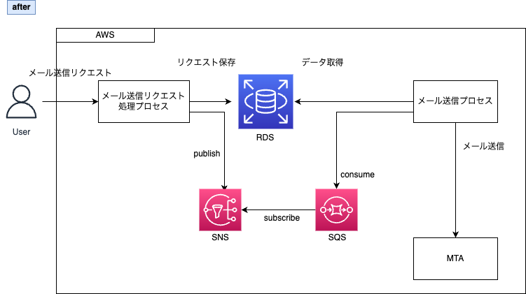
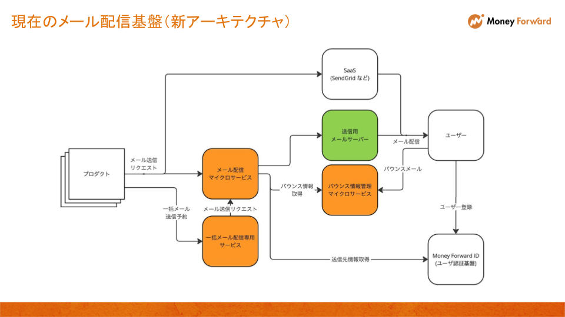

# メール

- バウンス
  - 宛先側の問題で送り返されたメールのこと
  - ソフトバウンス
    - 一時的なもの
    - 時間を置いて再度送る
  - ハードバウンス
    - 恒久的なもの
    - その宛先にはもう送らない
  - sendgridとかで送信するときにバウンスが大量発生すると、アカウントが停止されたりするから注意
    - https://support.sendgrid.kke.co.jp/hc/ja/articles/206431885-大量のメールを一斉配信する前に気をつけることはありますか
- メールヘッダ
  - [電子メール - Wikipedia](https://ja.wikipedia.org/wiki/%E9%9B%BB%E5%AD%90%E3%83%A1%E3%83%BC%E3%83%AB#%E3%83%98%E3%83%83%E3%83%80%E3%83%BC%E6%83%85%E5%A0%B1)
    - 代表的なヘッダフィールドについて書いてある
  - ヘッダ一覧
    - Cc
      - >Toで指定した本来の送信先以外にも、一応複製を送っておきたい相手などがいる場合に使用する
    - Bcc
      - >ToやCcに指定した相手には知られずに、複製を送信したい相手を指定する場合に使用する
    - From
      - >このヘッダーの記載は送信者がメールクライアントの設定によって自由に変更できる。このようなメールの仕様から、いわゆる「なりすまし」などの悪用を完全に防ぐことは困難とされる。
    - Received
      - >このメールが届くまでに経由したメール転送エージェント（IPアドレス）および経由した日時
    - Reply-To
      - >送信者が返信先として希望するメールアドレス
    - Sender
      - >送信者のメールアドレス。名前も含められる。著者と送信者が同一、すなわちFromが単一のアドレスでSenderと同じ場合は使うべきではない。逆に、異なる場合は必須である。
    - Subject
    - To
    - X-FROM-DOMAIN
      - >送信者のドメイン
    - X-IP
      - >送信者のグローバルIPアドレス
    - Delivered-To
      - [Delivered-To【メールヘッダ】とは｜「分かりそう」で「分からない」でも「分かった」気になれるIT用語辞典](https://wa3.i-3-i.info/word11114.html)
      - >「このメールは、ここに配達しました」な情報が書かれているよ
- メーリングリスト
  - ML
  - チームとして使う外部サービスのアカウントにはMLのアドレスを使おう！
- [Gmailが2024年2月から(大量)送信者に求めてることが分からない闇への防衛術(後編)  - Qiita](https://qiita.com/nfujita55a/items/51eefd1e9578927e118a#google%E3%81%8C%E5%A4%A7%E9%87%8F%E9%80%81%E4%BF%A1%E8%80%85%E3%81%AB%E6%B1%82%E3%82%81%E3%81%A6%E3%81%84%E3%82%8B%E3%81%93%E3%81%A89%E3%81%A4%E3%82%923%E3%81%A4%E3%81%AB%E5%88%86%E9%A1%9E)
**Gmailさんが求めている事項**

| 項番 | 内容 |
| --- | --- |
| ① | SPFとDKIMつけてメールを送ってね |
| ② | 送信するIPアドレスを full-circle reverse DNS にしてね |
| ③ | 迷惑メール率を低くしてね(0.3%, 0.1%) |
| ④ | メールのフォーマットは正しく |
| ⑤ | gmailじゃないのに なんとか@gmail.com をFromにしてメールを送るな |
| ⑥ | 転送するときはARCヘッダー付けてね |
| ⑦ | p=noneでいいからDMARCレコードを発行してね |
| ⑧ | 人が送るメールではヘッダFromとEnvelope-From は同じにしてね。同じにならないならヘッダFromのドメインで署名したDKIMつけてね |
| ⑨ | オプトイン(配信許諾)が必要なマーケティング目的のメールは、ワンクリックでの登録解除ができるようにしてね |

- [実務で使える メール技術の教科書 基本のしくみからプロトコル・サーバー構築・送信ドメイン認証・添付ファイル・暗号化・セキュリティ対策まで（増井 敏克）｜翔泳社の本](https://www.shoeisha.co.jp/book/detail/9784798183930)
- [メール受信トリガーで処理をする方法をあれこれ比較  - Qiita](https://qiita.com/yugo-yamamoto/items/e1288bfb177887bfea64)
  - 自前Postfix
  - SendGrid でやる
  - Cloudflare Email Workers
  - Amazon SES Lambda でメール受信トリガー
  - Google App Engineでメール受信トリガーの例
- [マネーフォワードのこれからのメール送信を支えるマイクロサービス開発 - Money Forward Developers Blog](https://moneyforward-dev.jp/entry/2022/10/28/supporting-email-sending/)
  - 
- [Encraft#16での「マネーフォワードを支えるメール配信基盤」の登壇で話しきれなかったメール配信基盤の歴史について - Money Forward Developers Blog](https://moneyforward-dev.jp/entry/2024/08/27/100000)
  - 
- [KARTE Messageで採用している大量配信を実現するためのアーキテクチャ](https://tech.plaid.co.jp/karte_message_mass_delivery_architecture)
