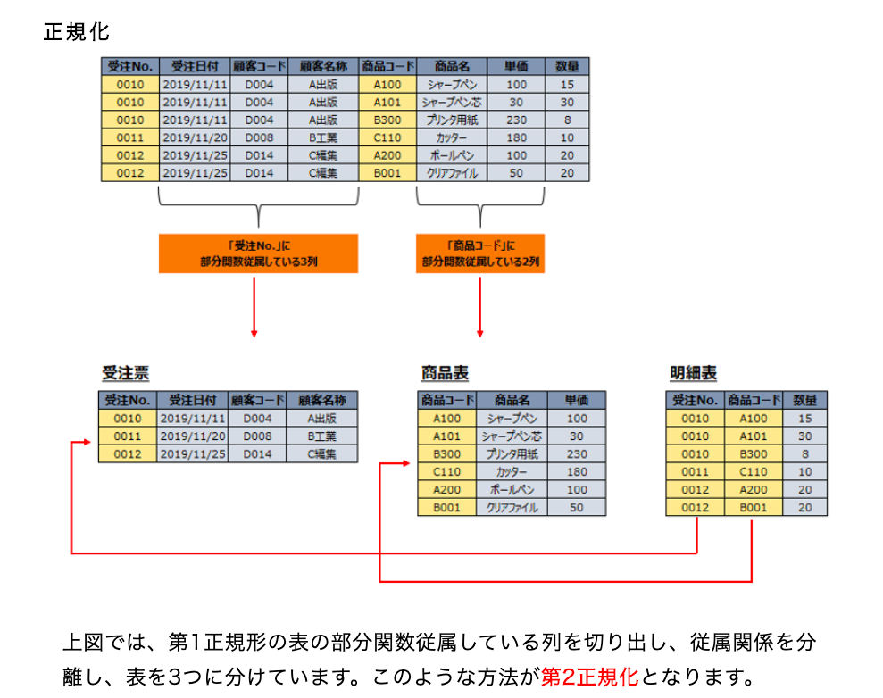
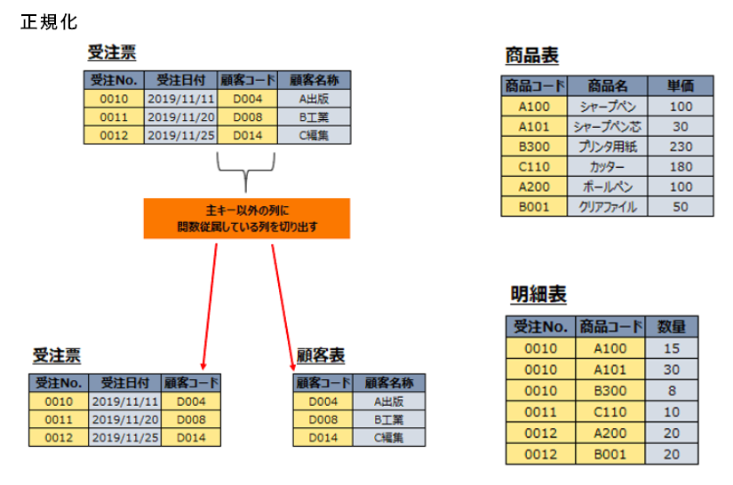

# リレーショナルモデルと正規化

- 概念モデル
  - 実世界のデータをDBで扱えるようにしたもの
  - 二次元表の他にも、ネットワーク型とかも含まれる
- ドメイン
  - 集合のこと。無限集合も有限集合も
  - `D1 =  {1,2,3}, D2 = INTEGER, D3 = {x|x > 10}`など
  - 直積をとれる。2個以上(<=1つもOKかも)の直積の1つがリレーション。DBでいうと1レコードのことかも?
- タプル(タップル)
  - リレーションRの各要素
  - `R = { (1,a,あ), (2,b,い), (3,c,う), (4,d,え) }`の`(1,a,あ)`の事
- 濃度
  - Rのタプルの総数
  - DBでいうとCOUNTでの行数かも? 上の例だと4
- 次数
  - リレーションのドメイン数。
  - DBだとカラム数? 上の例だと3
- ドメイン関数
  - ???
- 第一正規形
  - シンプルな(データ型的な)ドメイン上で定義されたリレーション
- 候補キー
  - 複数の属性値でタプルを1つに固定できるキーたち
- 主キー
  - primary key. これだけで一意
  - nullはダメ
  - 書くときはアンダーバーを付ける $ R(A1, ... , \underline{Ak}, ..., An)
- 外部キー
  - foreign key.
- 一貫性制約
  - キーの制約(整合性保つ、とか)
  - 検査制約(値を制限、とか)
- リレーショナル代数
  - 4つの集合演算
    - 和集合演算、差集合演算、共通集合演算、直積演算
  - 4つのリレーショナル代数特有の演算
    - 射影演算、選択演算、結合演算、商演算
- 和集合演算
  - `UNION`
  - $ R \cup S
- 差集合演算
  - `NOT EXISTS`
  - $ R - S
- 共通集合演算
  - INTERSECT
- $ R \cap S
- 直積演算
  - `OUTER JOIN`
  - $ R \times S
- 射影演算
  - `SELECT`句でカラムをいくつか指定
  - [リレーショナルデータベースの関係演算(選択,射影,結合)｜SQL講座](http://www.pursue.ne.jp/jouhousyo/SQLDoc/RDBsousa.html)
- 選択演算
  - `SELECT`句でカラム指定して`WHERE`
- 結合演算
  - (INNER) JOIN
- 商演算
  - >表 S の全ての属性の値を同時に満たす、表 R の行を選び出し、 S の属性を取り除いた列を取り出す演算である。
    - [テーブルの商演算について データベース試験: 房州人の男塾](https://kominato.exblog.jp/2098676/)
  - サブテーブルのカラムが全部候補キーのとき、メインのテーブルをもってきて、そのカラム以外を取り出している
- リレーショナルデータベースの設計
  - 正規化の次元が高いほど安全性も高い
- 第1正規形
  - データ型のみのテーブル
- 第2正規形
  - 第1正規形であること
  - 行Rのすべての非キー属性はRの各候補キーに完全関数従属している
    - 非キー属性
      - すべての候補キーに属していない属性
    - 候補キー
      - リレーションのタップルを唯一識別できる属性の最小の組
    - 関数従属
      - カラム`A1 ~ Ak`がすべて一致している任意2つの行(リレーションR)が、カラム`B1 ~ Bm`も一致しているとき、リレーションスキーマ`R(A1,...,Ak,B1,...,Bm,C1,...,Cj)`に`関数従属性 A1...Ak -> B1...Bm` が存在するという
    - 完全関数従属
      - 関数従属性`X -> Y`について、$ X' \subset Xについて `X' -/ -> Y` のとき、YはXに完全関数従属しているという
  - [【関係データベースの正規化】第1正規形・第2正規形・第3正規形について紹介 | BREEZE](https://breezegroup.co.jp/202005/database-normalization/) がわかりやすかった
    - 
- 第3正規形
  - [【関係データベースの正規化】第1正規形・第2正規形・第3正規形について紹介 | BREEZE](https://breezegroup.co.jp/202005/database-normalization/)
  - >第2正規形の表から、主キー以外の列に関数従属している列が切り出されたものを第3正規形とされています
  - >主キー以外の列に関数従属している列のことを推移的関数従属と呼ばれていたりします
  - 
- ボイス・コッド正規形
  - >すべての関数従属の決定項が**スーパーキー**（候補キー）であるような第3正規形
- 第4正規形
  - https://www.atmarkit.co.jp/ait/articles/1703/01/news183.html
- 第5正規形
  - https://www.atmarkit.co.jp/ait/articles/1703/01/news183_2.html
- サブクエリは3種類
  - テーブルサブクエリ
    - IN, FROM, EXIST
  - スカラサブクエリ
    - 空はNULLになる
      - COALESCE関数で排除できるNULL
  - 行サブクエリ
    - 空はNULLになる
- リレーション操作とSQLの対応
