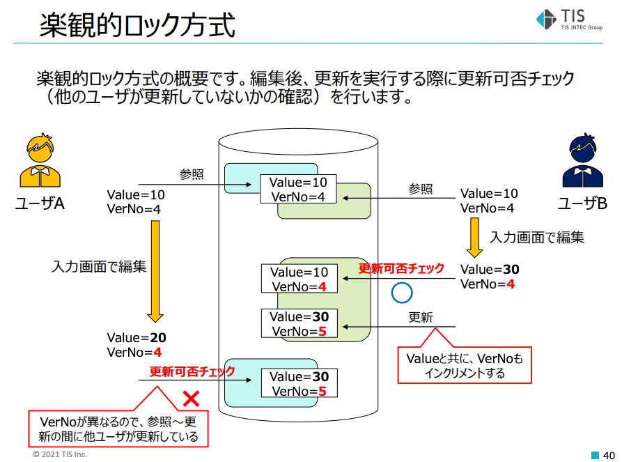
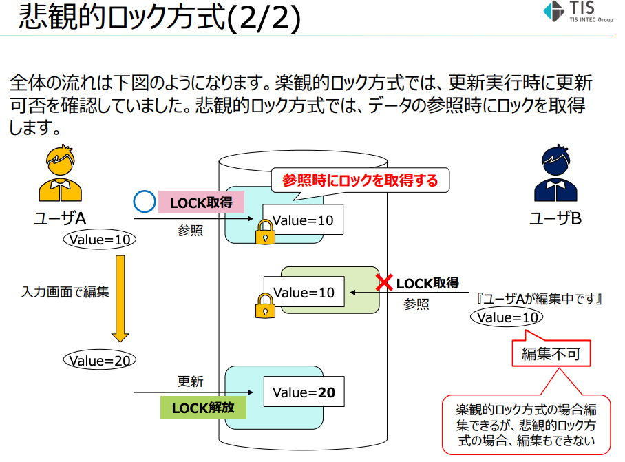
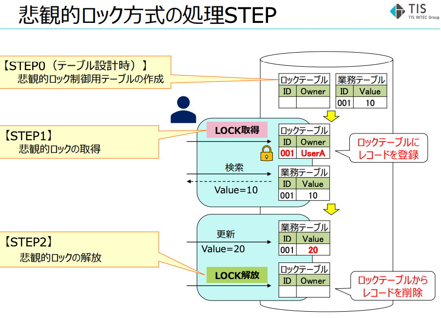

# ロック

- ロックの用語整理
  - 共有
    - 更新のみロック
  - 排他
    - 参照も更新もロック
  - 楽観
    - アプリ側で実装する、参照時後の更新時に別の更新が入っていたらやめる、という処理をするロック
    - 参照時のupdated_atを更新時のWHERE句入れたりして実装する
  - 悲観
    - データベース側で、SELECT時にロックをかける(FOR UPDATEでSELECTする)
- デッドロック
  - ある処理はA→Bの順でロックをとって、別のある処理はB→Aの順でロックをとったとき、デッドロックが起きうる
  - ロック順序を指針として予め定めておいて、それを守ってコーディングして回避
  - [第12回　デッドロックについて](https://oss-db.jp/dojo/dojo_12)
- `SELECT FOR UPDATE`
  - トランザクション内で行われるSELECT句の最後に`FOR UPDATE`をつけると、他のトランザクションはそのSELECTした行の更新ができなくなる
    - 更新ができなくなるだけで、参照はできてしまう(参照のロックはとっていない)ので注意！
- [データベースの排他制御](https://fintan.jp/wp-content/uploads/2022/03/Database-Exclusion-Control.pdf)
  - 排他制御設計とは
    - 排他制御：複数のユーザやトランザクションが同時に同じデータを操作できないようにする仕組み
    - 目指すもの
      - データ整合性の維持
      - スループットの最大化
        - > 排他制御がされていても、設計が不十分だとスループットが低下する
  - 排他制御を実現するための技術要素
    - 物理ロック：**DBMSで実現されているロック機構**
      - 共有ロック
        - >自トランザクションがそのデータを**読み出している**ことを、他のトランザクションに示すために取得するロック。他トランザクションは参照のみ可能
      - 排他ロック
        - > 自トランザクションがそのデータを**更新していること**を、他のトランザクションに示すために取得するロック。他トランザクションは参照も更新もできない
      - 更新ロック
        - >自トランザクションがそのデータを**後で更新する予定**であることを、他のトランザクションに示すために取得するロック。他トランザクションは参照のみ可。更新を実行すると、そのまま排他ロックに格上げされる
          - `SELECT ... FOR UPDATE`はコレ
    - 論理ロック：**アプリケーションレイヤーで実現するロック機構**
      - 楽観的ロック方式
        - >編集後、更新を実行する際に更新可否チェック（他のユーザが更新していないかの確認）を行います
        - 
          - 上記では`VerNo`(バージョン番号)というカラムを使って、アプリケーションレイヤーで実装している
            - 代わりに`updated_at`カラムを使う方法もあるけれど、そうするとミリ秒単位で同時に更新された場合は防げない
        - >業務要件上許されるのであれば、楽観ロックが実現コスト面で有利
      - 悲観的ロック方式
        - >操作開始時点でロックを取得し他のユーザが変更できないようにする方式
        - 
        - 
        - 悲観的ロック制御用のロックテーブルを作ることで実装する
          - ロック取得：ロックテーブルにレコードを登録する
          - ロック解放：ロックテーブルのレコードを削除する
  - トランザクション分離レベルに関してはトランザクション分離レベルのページに書いた
  - ↓なども書いてあるけれど省略
    - ロックの互換性
    - 排他制御設計の考え方
- **データベースのロック機能を使わなくても、アプリケーションレイヤーの工夫で解決できるならそれが良い！**
  - たとえば複数jobが余っているレコードを1件ずつfetchするような処理は、一見レコードのロック(場合によってはアドバイザリーロック)が必要そうに見える
  - 各jobのinitialize時に、どのレコードを処理するかを引数で与えて、jobの数はsidekiqとかの最大プロセス数を設定することで制御すれば、ロックのことを考える必要なしに機能を実装できる!!
- レコードロック (行ロック)
  - `SELECT ... FOR UPDATE`して行に対してロックをかけること
- [アドバイザリーロック](勧告ロック)
  - 詳しくは：[排他制御のためだけに Redis 渋々使ってませんか？データベース単独でアドバイザリーロックできるよ！](https://zenn.dev/mpyw/articles/rdb-advisory-locks)
  - ユーザー側が実装するロック手法のうちの一つ
  - リソースの新規作成時などで`SELECT FOR UPDATE`の結果がNULLだったとき、全レコードにロックが掛かってしまう
  - 代わりに、存在が保証されている別のリソースをロックする手法
    - ここでusersとかをロックしてしまうと、全く別種の「処理Aからのusersのロック」「処理Bからのusersのロック」で競合してしまう
    - なので、処理の種類ごとアドバイザリーロック用テーブルを作るのが吉
  - DB組み込みでアドバイザリーロック用の関数が用意されている
    - MySQL
      - `GET_LOCK(str text, timeout integer)`
      - 完了後は`RELEASE_LOCK()`する
      - Railsから使う場合は[with_advisory_lock gem](https://github.com/ClosureTree/with_advisory_lock)を入れて、`ApplicationRecord.with_advisory_lock('文字列') { 処理 }`のように使うみたい
    - 全部自前でやる場合
      - ロック専用テーブルを作っておいて`SELECT ... FOR UPDATE` を利用する
- DBでロックを扱う上で、使う観点から見たとき、選択肢は上記の2つがある
  - 悲観・楽観・共有・排他 は、それらの分類の話
- MySQLの`select for update`が取るロック
  - → レコードの[** 排他ロック](参照も更新も不可)をとる
  - https://dev.mysql.com/doc/refman/8.0/ja/innodb-locking-reads.html
    - >SELECT ... FOR UPDATE は使用可能な最新データを読み取り、読み取られる各行上に排他ロックを設定します。 したがって、検索された SQL UPDATE によって行上に設定される場合と同じロックが設定されます。
  - 一方で、MySQLのデフォルトのトランザクション分離レベル REPEATABLE READ では、別セッションから(for updateなしの)通常のselect句を発行する場合、他のトランザクションによって設定されたロックを無視して読み取れるらしい
    - 内部でトランザクション直前の値を別途保持して参照してもらう、MVCC (Multi-Version Concurrency Control)という機能によって実現されている
    - トランザクション分離レベルがREAD COMMITTED と REPEATABLE READ (MySQLのデフォルト値) の場合はこの挙動になる
    - https://dev.mysql.com/doc/refman/8.0/ja/innodb-consistent-read.html
      - > **一貫性読み取り**は、InnoDB が READ COMMITTED および REPEATABLE READ 分離レベルで SELECT ステートメントを処理する際のデフォルトモードです
    - https://dev.mysql.com/doc/refman/8.0/ja/innodb-locking-reads.html
      - > **SELECT ... FOR UPDATE**
      - > 検索で検出されたインデックスレコードについては、それらの行に対して UPDATE ステートメントを発行した場合と同じように、**行および関連するインデックスエントリがロックされます**。
      - > ...
      - > 一貫性読み取りでは、読み取られたビュー内に存在するレコードに設定されたロックはすべて無視されます。
