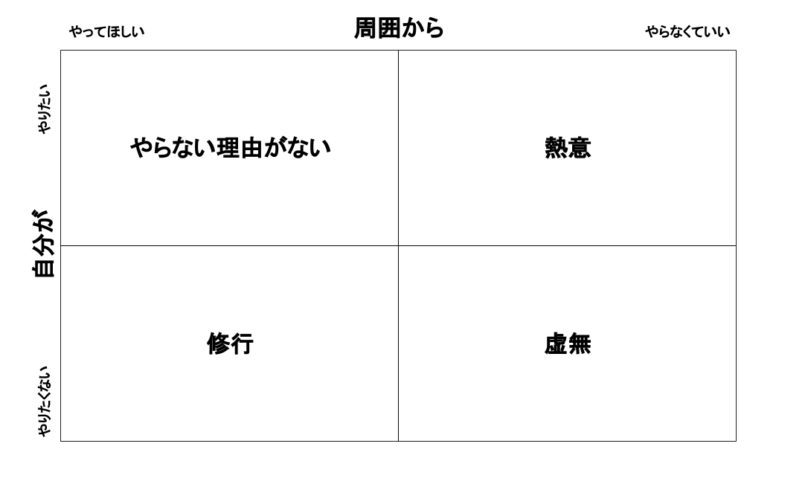

# 仕事術

- [チーム開発で活躍するために、自分の庭を作れると良い - hitode909の日記](https://blog.sushi.money/entry/2020/06/27/114814)
- [【ポエム】コミュ力低いプログラマがサラリーマンで生きていくために工夫すべきと思うこと - Qiita](https://qiita.com/ota-meshi/items/ce19054f552f681f72ec)
  - 細かいことはどうでもいい
    - 聞かれたら答えたらいい
    - 概要だけは伝える
- [プログラマとしてOSSと関わりながら生き残るためにとった生存戦略 - xuwei-k's blog](https://xuwei-k.hatenablog.com/entry/20150930/1443641775)
  - すごい人(コミッターとか)の半生や生活とかが見れた
- 謝るとき
  - [ITエンジニアのための謝罪メソッド - 山本ゆうごブログ](http://yugoyamamoto.hateblo.jp/entry/2018/12/24/161253)
    - >謝罪の経緯書はだいたいこういうフォーマット。
      - トラブルの概要
      - 時系列
      - サービスに対する影響範囲
      - 直近の対応
      - 原因
      - 根本対応
      - 組織としての対応
    - >「これあった方が絶対楽だよなぁ」と自分達でも思える対策が必要
    - トラブルの概要
    - 時系列
      - >「どうやってトラブルが発覚したのか？」「それを伝達するルートはどうなのか？」「対応できる人までたどりついたのか？」をあとで振り返るのに有効
    - サービスに対する影響範囲
    - 直近の対応
    - 原因
    - 根本対応
      - システムで解消
    - 組織としての対応
- 仕事のマネジメント(仕事のアサイン)
  - [メンバーに「この仕事、やりたい仕事じゃないです」と言われたら？(動画つき)｜長村禎庸@EVeM｜note](https://note.com/nagam/n/n3d30dbba2814)
- 事業がわかるエンジニア
  - [「事業がわかるエンジニアがいない」 - 山本ゆうごブログ](https://yugoyamamoto.hateblo.jp/entry/2020/10/08/142604)
  - 社会人としての成長段階
    - 自分の成長をコントロールできる
      - >めちゃくちゃお勉強が得意な人がそこで止まりがち
    - チームの成長をコントロールできる
      - >小さなところでは新人教育ができるかどうか。
      - >成長してくると「決済を通す」ってことをやるようになる。
        - ＝稟議を通す
    - 上司をコントロールできる
    - 顧客をコントロールできる
    - 市場をコントロールできる
    - >さらに、エンジニアには、「技術の限界をコントロールできる」が加わる。つまり発明。
- 仕事の能率を上げる工夫
  - 積極的に聞くようにする
  - 聞くとき、相手が答えやすいように
    - 状況は完結に説明する
    - 回答の選択肢を絞って、メリット・デメリットもわかりやすく説明して質問
- ミスを減らす
  - [失敗学 - yuiseki](https://scrapbox.io/yuiseki/%E5%A4%B1%E6%95%97%E5%AD%A6)
  - 機能改修で既存の挙動は変えないように注意
  - テストを書くようにする
  - [【非テストエンジニア向け】即効バグ出し技法集 - Qiita](https://qiita.com/illypong/items/5e3729f0ee8bface214c)
- イベントごとを主催するときに、どの観点を持てばいいかの参考になりそう
  - [RubyKaigi 2023 followup event 企画案 - HackMD](https://hackmd.io/@ko1/rJwaBtuBh)
- 目標は定性で測れるものと定量で測れるものの2つを立てるのが良さそう
- [エンジニアのこころがけ - 山本ゆうごブログ](https://yugoyamamoto.hateblo.jp/entry/2022/12/24/100305)
  - 1. ググって1ページ目に来るブログを書こう
  - 2. 大事なのはプログラムではなくプログラムよって作られたデータである
  - 3. データの偏りとリズムを見つけよう
  - 4. 機械に優しいデータを作れば機械が恩返ししてくれる
  - 5. 寝てる間に動くシステムが最強のUX
  - 6. エンジニア人気言語ランキングは気にするな。レアキャラになれ
  - 7. データの専門家だけはどこでも通用する
  - 8. ゆるいオーダーこそチャンス。美しいルールをつくりましょう
  - 9. 良いルールは声に出して伝わるルール。伝わらないルールは伝わらないUXになる
- [中途入社のソフトウェアエンジニアがWebサービス開発に参加するとき役立ったこと - kymmt](https://blog.kymmt.com/entry/onboarding-2023)
  - どのようなサービスかを調べる
  - どのようにデータを保持するかを調べる
  - どのようなコードかを調べる
  - 「未知の未知」をできるだけ早く減らす
  - チームの開発体制に興味を持つ
- [やりたいことがない人のためのキャリア形成論｜dora_e_m](https://note.com/dora_e_m/n/nefbe76becb68)
  - 
  - >最後に残った「修行」の象限。「やらない理由がない」ものも「熱意」に該当するものもないという人は、ここをベースに「得意かもしれないこと」「潜在的にやりたいこと」を見つけていきます。
  - > 「やりたいことが特にない」あなたが「やりたいこと」を探すには、そこからキャリアを形成していくには、まずは「目の前にある仕事がやりがいにつながるか」を検証する必要があります。
- 方針を決めるとき
  - 具体的にどのように行うかのイメージまでして、実行時の困難を見逃さないようにする。
    - 例：DBのデータ受け渡し
      - 先方に主要なデータを渡すとき、一見丸々DBを渡すのが楽そうに思えるけれど、データ量の問題もあるしそもそもどう渡すかも決めないといけないしで結構懸念がある。既存のデータ受け渡しフローに乗っかるやり方ならば、フローに乗せる工数はかかるけれど、十分に慣れた作業で行えるというメリットがある。
        - ↑ **どう渡すか**までイメージすると色々困難が見えてくる例
- 「達成条件」観点でタスクを分解
  - 難易度の高いタスクは**「やること(= 作業内容)」観点で分解する前に「達成条件」観点で分解する**こと
  - タスクの分解には2種類ある
    - 「やること(= 作業内容)」観点で分解する方法
      - あまり意識しないでタスクを進めると自然とこの方法と取りがち
    - 「達成条件」観点で分解する方法
      - やること観点で進めると、後半の作業で手戻りが起きたときにその巻き取りがやりにくい
