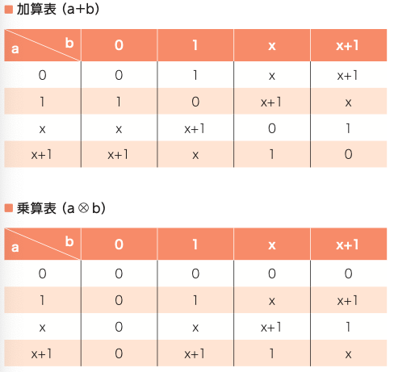
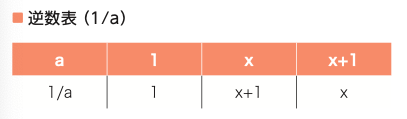

# 公開鍵暗号

## 暗号と認証のしくみと理論がこれ1冊でしっかりわかる教科書

- [図解即戦力 暗号と認証のしくみと理論がこれ1冊でしっかりわかる教科書：書籍案内｜技術評論社](https://gihyo.jp/book/2021/978-4-297-12307-9)

- **4章 公開鍵暗号**
- **18 鍵共有**
  - 「ディフィー・ヘルマン鍵共有(DH鍵共有)」
    - `g`と`n`は公開されている数字
    - お互いに秘密の数`a`を用意して、それを累乗につかった余り`g^a mod n`を教える
    - お互いに貰った値`b`を使って`g^ab mod n`を計算すれば、その値は2人だけのもの
  - DHP (DH Problem) の難しさを使った仕組み
    - 突き詰めると離散対数問題「`g, n, A`から`A = g^a mod n`を満たす`a`を求めよ」
    - `a`から`A`を求めるのは簡単だけれども、`A`となる`a`を求めるのは難しい→一方向性関数
- **19 有限体と拡大体**
  - 乗算表
    - modを取った値による掛け算表
  - 逆算表
    - 除算をうまく定義してあげる
    - `x (= 1/a)`を、`ax = 1`と考えて、「`a`に掛けたら`1`となる数」を`x`とする
  - 体
    - 加減乗除の四則演算ができる集合
    - modが素数ならいつでも除算が定義できる
  - 「有限体」
    - 有限個の集合 からなる体
    - $ \mathbb{F}_p = \{0,1,...,p-1\} (pは素数)
    - $ \mathbb{F}_2はビット演算と同じ
  - 「拡大体」
    - $ \mathbb{F}_2をまとめて扱う
    - 2つまとめて扱うと、$ \mathbb{F}_{2^2}
      - $ b_1 x + b_0のような感じ
      - $ 00 = 0x + 0 = 0
      - $ 01 = 0x + 1 = 1
      - $ 10 = 1x + 0 = x
      - $ 11 = 1x + 1 = x + 1
      - この$ xの式を使って加減乗除ができる
- 
- 
- **20 公開鍵暗号**
  - 「公開鍵暗号」という言葉は暗号の実装ではなく暗号の性質（特徴？）を指す
    - 暗号化する側が、受け取った公開鍵からどのように平文を暗号化するかは、実装による
- **21 RSA暗号**
  - 「RSA暗号」
    - なんかムズい整数の剰余に関する性質を使っている
    - やっていることは、累乗の余りをとっているだけなのでDH鍵交換っぽい
- **22 OpenSSLによるRSA暗号の鍵の作り方**
  - OpenSSL
    - 暗号技術用のツール
  - `openssl genrsa 2048 > sec-test-key.tx`
  - `openssl rsa -pubout < sec-test-key.txt > pub-test-key.txt`
- **23 楕円曲線暗号**
  - 楕円曲線 EC(Elliptic Curve)
  - $ \mathbb{F_{2^n}}ではなくて「楕円曲線上の演算」という体を用いた暗号
- **24 中間者攻撃**
  - 6章の内容なので略
