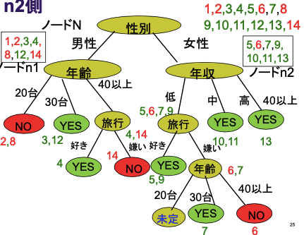
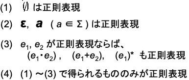
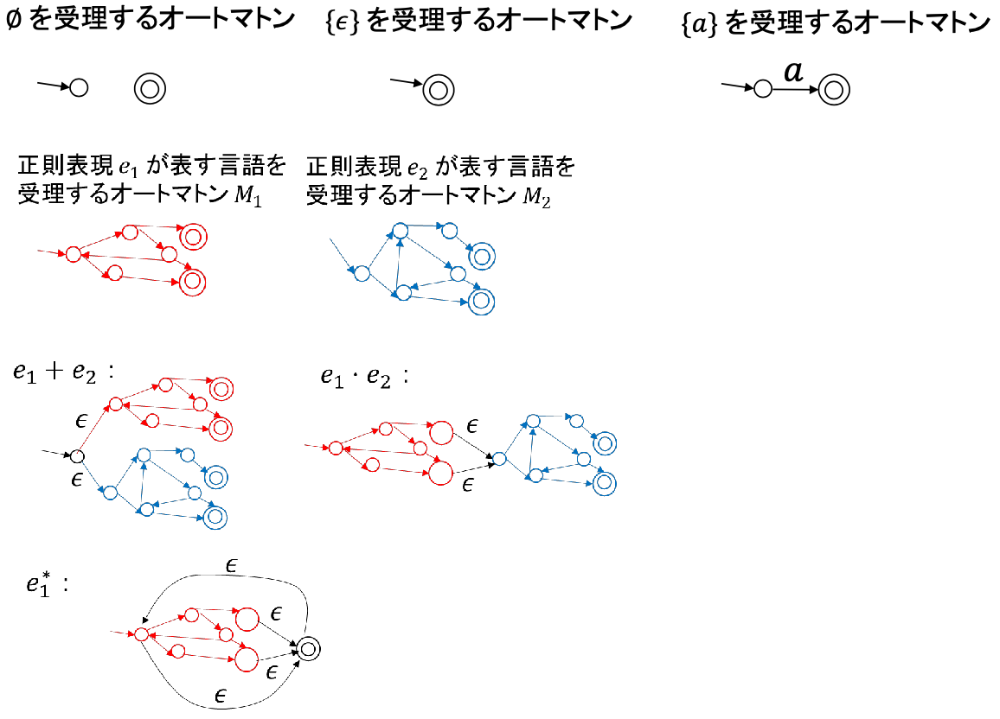
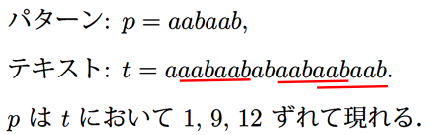

# 情報処理・アルゴリズム

- **探索**
  - ドメイン知識を使うのがヒューリスティック探索、ブラインド探索
  - ブラインド
    - 深さ優先探索
      - 超巨大な木では使えない
    - 幅優先探索
    - 反復深化法
      - 徐々に深くしていく深さ優先探索
    - 均一コスト探索
      - ダイクストラ法と同じロジックで、経路が短い順に探索
  - ヒューリスティック
    - 貪欲法
      - グラフとは関係無い情報(直線距離とか)を基準にしたり
    - A*アルゴリズム
      - 評価関数`h(n) + g(n)`で貪欲法
        - `g(n) = (スタートからノードnまでの最短経路)`
          - 確定済みの値
        - `h(n) = (ノードnからゴールまでの最短経路の近似値)`
          - 近似の部分にヒューリスティックを使う
      - 全てのノードで`h(n) <= (ノードnからゴールまでの最短経路)`(許容的ヒューリスティック)なら、最適な解が見つかる
- **最適化問題**
  - 最適化問題を構成する要素3つ
    - 探索空間
    - 制約条件
    - 目的関数
      - 最大化の対象(問題によっては最小化)
  - 探索とは違って、ゴール(最大)かどうかの判定ができない
  - 局所探索アルゴリズム
    - 山登り法
      - 「ある点の近傍で、評価値が最大のその点以外の点があれば、そこに移動」を繰り返す
      - 局所解に陥りやすい。対策としては
        - ランダムにスタート位置を変えるのを何度か繰り返す
        - 最大だけじゃなくて上位k個の点を使って、山登り法をk個走らせる(局所ビーム探索)
    - 焼きなまし法(Simulated Annealing, SA)
      - 山登り法のアルゴリズムで、目的関数の悪化を、最初は大きく許容、徐々に小さく許容していく
        - 値の悪化時に、確率で悪い値に更新する
    - 遺伝的アルゴリズム(Genetic Algorithm, GA)
      - 「淘汰→交叉(こうさ)→突然変異」で解集合を更新していく。数千世代くらいの単位で繰り返す
      - 淘汰
        - いくつかの点(ここではN点)で評価値を計算して、評価値の高さに比例した確率でそのN点の中からN個を重複アリで選ぶ。1度も選ばれなかったものが淘汰される
      - 交叉
        - 適当に解のペアをいくつか作って、ペアをいい感じに組み合わせて新しいペアを作る
      - 突然変異
        - 稀に、解の次元値をランダムに変える
        - 未訪問の探索空間を調べるため
  - 蟻コロニー最適化
    - 蟻🐜が餌から巣まで往復するときの行動を模してる
    - TSP問題、2地点間の最短経路探索 とかに使える
    - 辺はフェロモン量という重みを持っていて、蟻はフェロモン量に比例、経路長に反比例した辺を通る。通った辺のフェロモンは増えて、ループ毎に各辺のフェロモンを一定量減らす。
- **推論**
  - 推論規則modusponens(モーダス・ポーネンス)
  - $ ((A→B)∧A)→B
  - 前向き推論
    - 事実とルールから、成り立つ規則を全て求める
    - モーダス・ポーネンス推論規則を元にしている
    - 処理の流れ
      - まず、適用可能なルール集合を決定する「マッチング」
        - ワーキングメモリには、事実が入っている。これをルールの条件部と比較する
        - 比較して、適用可能とわかったルールの集合を、競合集合という
      - 次に、ルール集合から1つ選ぶ「競合解消」
        - 競合集合からいいかんじに1つ選ぶ
      - そのルールを実行し、新事実をワーキングメモリに記憶
  - 後ろ向き推論
    - ゴールGに向けて、それが成立することを示す
    - 流れ
      - Gを実行部に含むルール(C→G)を探索
      - Cが成立するかどうかを、Cをゴールとして後ろ向き推論で調べる
  - SATソルバー
    - 命題論理式Pを充足する解釈が存在するかを判定
      - 解釈: 命題論理式への真偽の割り当て
      - 命題変数の数がnだと2^n通り
  - 推論システムの限界
    - 知識獲得が大変
      - 専門家の知識が必要
    - 自己成長しない
      - 人間が新たな知識を追加する必要がある
- **知識発見**
  - データマイニング
    - 相関データマイニング
    - クラスタリング
    - 決定木
  - 相関ルールマイニング
    - データベースから強い相関ルールを(頻出アイテムセット)発見する
    - 支持度
    - $ |A \cap B|/|D|
      - 対象のデータ数/データ数全体
    - 確信度
    - $ |A \cap B| / |A|
      - 対象のデータ数/対象の一部が入っているデータ数 (この式の場合はA)
  - 頻出アイテムセットを全列挙で求めると、調べる数が指数的になってしまう
  - そこで、アプリオリ(Apriori)アルゴリズム
    - セット数を1から徐々に増やす
    - セット数N個はセット数N-1個から求める
    - 頻出なセットのみを次の頻出セットの計算に利用する
  - クラスタリングには階層型と非階層型がある
  - 非階層型のクラスタリング手法
    - k-means
      - 有名な非階層クラスタリング手法
      - N個のクラスタにしたいとき、テキトーにN個点を決めて(クラスタの代表点)、全ての点がどのクラスタに所属するか計算する
      - その後、クラスタごとに点の平均が次のクラスタの代表点となる
      - 少なくとも局所最適解には到達する
      - 最初のランダムな座標選びで、各々の代表店をできるだけ遠くに置くようにすると良い
  - 階層型のクラスタリング手法
    - まずは非階層型でクラスタを作って、それをマージしていくことで階層構造を作っていく
    - マージの処理で手法が分類される
    - Single Link法
      - 点の距離が最も近い2つのクラスタのペアをマージ
    - Complete Link法
      - Single Link法は2つのクラスタ間の「最も近い2点の線」が最も近いものをマージしていたけれど、Complete Linkでは「最も遠い2点の線」が最も近いものをマージする
  - 内的結合度
    - 重心からの点の散らばり具合
    - 小さいほど良いクラスタリング
  - クラス分類
    - オブジェクトを、その属性を利用してクラス分けする作業
    - 「色が黄緑&手がカマ状&大きさが8~10cm→カマキリ」のような感じ
    - 決定木
      - 木のようにネストしたif条件で分類
  - 決定木の構築
    - (前提) データベースはDBのレコードのようなもので、各行がどのクラスかは既知。今後現れる未知のレコードを分類する
    - そのノードの全てのレコードが同じクラスならそこで終了(新しい行はそのクラスに分類)
    - そうでなければ
      - 未選択の属性を1つ選ぶ
      - 属性値の種類を子ノードとして追加
        - 「生息地」カラムが「海、山、川」だったら、3つの子ノードができる
      - 全ての子ノードについて上の手順を繰り返し
    - ポイント
      - 兄弟(同じ深さの)ノードごとに、その子にする属性はバラバラでOK
      - サンプルデータによっては、新しいノードが「未定」に分類されることもある
    - 例：「ワインを飲むか?」
      - 
    - 未定ノードへの対応
      - 先祖を見て多い方にする
        - 例: 祖父にあたるノードに属しているレコードが「YES, YES, NO」なら、この未定ノードはYESにしておく
  - 低い木が良い決定木
  - ID3アルゴリズム
    - 属性選択のところを頑張る
    - 偏りが激しくなる属性から選ぶと良い
    - 偏りの激しさは、情報エントロピーで測る
      - (属性選択前の情報エントロピー) − (属性選択後の情報エントロピー)
  - 情報エントロピー(情報量)
    - 確率事象の不確定度を表す量
    - $ X:確率変数
      - 値域: $ \{v_1, v_2, ..., v_m\}
    - $ p_i: X = v_iとなる確率
    - Xの情報エントロピーは$ -\Sigma_{i=1}^m p_i log_2 p_i
    - 例: サイコロのエントロピーは、p_i に 1/6 入れて計算して、log_2 6
  - 情報エントロピーの性質
    - 確定事項になるにつれてエントロピーはゼロに近づく
    - それぞれの確率が等しいときに情報エントロピーは最大となる
  - 決定木での情報エントロピー
    - S: 学習サンプル
    - S_i: クラスC_i に属する学習サンプル
    - $ p_i = |S_i| / |S| を使う
- **最小全域木**
  - アサイクリックグラフ
    - 閉路を持たないグラフのこと
      - 連結なら木
  - 最小全域木
    - 全域木のうち、辺の重みの総和が最小のもの
    - 一意に定まらないこともある
  - カット
    - グラフを真っ二つにする
    - 片方が空なのはNG
    - 
  - 最小全域木を求める方法
    - 
  - カットに対する軽い辺
    - カットと交差する辺のうち、最もコストが小さいもの
  - 最小全域木を求める方法の証明
  - 同型グラフだとしても、特に指定がなければ別物?
- **ハフマン符号**
**ハフマン符号.rb**

```
# Aは、[node, freq]的なやつ
q = PriorityQueue.new(A) { |(n,f)| f } # minが優先のプライオリティーキュー
until q.size == 1
  x, freq_x = q.pop
  y, freq_y = q.pop
  q.push([Node.new(l: x, r: y), freq_x + freq_y]
end


```

- **近似文字列照合問題**
  - レーベンシュタイン距離、編集距離
    - 挿入、削除、置換、を適用して変換するときの適用した回数
**編集距離**

```
F(i, j) = min(
  F(i-1, j-1) + (a == b),
  F(i-1, j)   + 1,
  F(i, j-1)   + 1
)

一次元構造
	文字列, グラフの道, 確率過程で生成される1次元系列
文字列の部分構造
 接頭辞, 部分文字列, 接尾辞
グラフの道の部分構造
 部分道, 開始点から始まる部分道

```

- **最長増加部分列問題**
  - 数列の数値をいくつか消すと増加列なら、それは増加部分列
  - 部分構造最適性
    - 大きな部分問題の最適解の部分構造が小さな部分問題の最適解になっている
  - 自身より短い列での最大、でDP
    - 式だとO(n^2)だけどメモ化とかすればO(n)のはず
**最長増加部分列**

```
l(i): 最終要素がa_iで終わる最長増加部分列
l(i) = max { l(j) + 1 | 0 <= j < i, l(j) < l(i) }
L = max { l(i) | 1 <= i <= n }

```

- **全点対間最短経路問題**
  - 重み付きグラフのすべての頂点間の最短経路とその重み、を求める
  - ワーシャルフロイド
    - k-1 から k を求めていて、これは「新たに頂点kを使えるようになったとき」と捉えることができる
    - i~k, k~j で分けたときを試して、そっちの方が良ければそっちの経路に更新
**ワーシャルフロイド**

```
d(i, j, k) : 中間地点が{1,2,...,k}に属しているようなiからjまでの最短経路の重み総和
d(i, j, k) = min(
  d(i, j, k-1),
  d(i, k, k-1) + d(k, j, k-1)
)

求めた重みから経路を求める
```

**ワーシャルフロイドから経路を求める**

```
p(i, j, k) : 中間地点が{1,2,...,k}に属しているようなiからjまでの最短経路におけるjの直前の頂点。無ければNULL。

k=nなら中間地点が{1,...,n}だから、実質中間地点の制限なし、ということ。

すべての i,j について p(i, j, n) が計算できれば、
(jの1つ前の頂点) = p(i, j, n)
(jの2つ前の頂点) = p(i, (jの1つ前の頂点), n)
(jの3つ前の頂点) = p(i, (jの2つ前の頂点), n)
... のように逆順に経路を復元できる。

すべての i,j について p(i, j, n) を計算する。

p(i, j, 0) =
  if i = j or w(i,j) = Inf
  then null
  else i

p(i, j, k) =
  if d(i, j, k-1) <= d(i, k, k-1) + d(k, j, k-1)
  then p(i, j, k-1) // kを使えるようになったけど元の方が短かったね、なときは引き継ぎ
  else p(k, j, k-1) // kを使ったらより短くなったときは、そのkを使う経路におけるjの直前の頂点、に更新


```

- **DFAの正則表現への変換**
  - オートマトン
    - あの状態遷移図みたいに表せるあれ
  - 決定性有限オートマトン(DFA (Deterministic Finite Automaton))
- $ M = (Q, \Sigma, \delta, p_0, F)
- $ Q : 状態の有限集合
- $ \Sigma : 入力アルファベット
- $ \delta : Q \times \Sigma \rightarrow Q (状態遷移関数)
- $ p_0 : 初期状態
- $ F : 最終状態の集合
  - 正則言語
    - あの状態遷移図みたいに表したあれが受け取れるもの
- オートマトンMが受理する言語
- $ L(M) = \{ w \in \Sigma^* | \delta(p_0, w) \in F \}
  - 正則表現
- 
  - 正則表現のオートマトンへの変換
- 
  - DFAの正則表現への変換
    - $ L(M) = L(e) となるような正則表現eを求めたい
- $ R(i, j, k) = \{ w \in \Sigma^* | w は状態 p_i から状態 p_j に、\newline途中で状態 p_l (1 \le l \le k ) だけを通って至るパスのラベル \} とする。
- $ R(i,j,k) = R(i,j,k-1) \cup R(i,k,k-1) (R(k,k,k-1))^* R(k,j,k-1)
- のように帰納的に求められる。
- $ R(1, l_i, n) = L(p_{l_i})
- **文脈自由文法の認識問題**
- チョムスキー階層
**チョムスキー階層**

| 制限の無い文法(句構造文法) | チューリング機械 |
| --- | --- |
| 文脈依存文法 | 線形拘束オートマトン |
| 文脈自由文法 | プッシュダウン・オートマトン |
| 正則文法 | オートマトン |

- 上の方ほど高計算能力
  - 文脈自由文法 (Context-free Grammar)
- $ G = (N, \Sigma, P, S)
- $ N: 非終端アルファベット
- $ \Sigma: 終端アルファベット
- $ P: A\rightarrow \alpha (A \in N, \alpha \in (\Sigma \cup N)^* ) の形をした生成規則の有限集合
- $ S: 開始記号(S \in N)
- $ 生成規則 \alpha \rightarrow \beta \in P に対して x = u \alpha v, y = u \beta v と書けるとき、 x \Rightarrow y と書く。
  - この式だとxやyに代入していてややこしいけれど、$ u \alpha v \Rightarrow u \beta v というだけのこと
  - Gによって生成される言語
- $ L(G) = \{ w \in \Sigma^* | S \Rightarrow^* w \}
  - チョムスキー標準形
    - 文脈自由文法のPが次を満たすとき
  - $ P: A \rightarrow BC, A \rightarrow a (A,B,C \in N, a \in \Sigma) の形をした生成規則の有限集合
    - 文脈自由文法はチョムスキー標準形にできる
  - 文脈自由文法の認識問題
    - 文字列が受理されるかどうか判定する問題
    - 導出過程は、、、DPしにくい
    - 導出木だとDPできる
  - [CYK法 - Wikipedia](https://ja.wikipedia.org/wiki/CYK%E6%B3%95)
```CKY
# 資料とはi,jを逆にする。その方がわかりやすいし。

w : 受理するか調べたい文字列
C(i, l) : w[i..(i+l)] を生成する非終端記号、の集合

C(i, 1) = { X ∈ N | X -> w[i] ∈ P }
C(i, l) = { X ∈ N |
  X -> YZ ∈ P,
  Y ∈ C(i, k),
  Z ∈ C(i+k, l-k),
  k = 1..(l-1)
}
i, l, k のループで、O(n^3)
数直線 1...i...(i+k)...l...n
長さ   |___|___k___|l-k|___|


```

- **隠れマルコフモデル**
  - 隠れマルコフモデル (HMM)
    - 状態を観測できないマルコフモデル
  - 定義
  - $ M = (Q, \Sigma, \delta, e, p_0, f)
  - $ Q: 状態の有限集合 = \{0,1,2,...,n,n+1\}
  - $ \Sigma: 有限アルファベット
  - $ \delta: Q \times Q \rightarrow 0,1 状態遷移確率
  - $ e: Q \times \Sigma \rightarrow 0,1 記号の出現確率
  - $ p_0 : 初期状態. p_0=0
  - $ f : 最終状態. f=n+1
    - 初期状態への遷移は存在しない
    - 最終状態からの遷移は存在しない
  - 例
- 
  - 出力(1~6)から状態(1 or 2)を予想したい
  - Viterbiのアルゴリズム
    - `状態数^出力数` 通りのパス各々について確率を計算して、最大のパスが予想された状態
    - 計算量が多い。 DPで工夫
```Viterbi
w : 出力された記号列
v(k,i) : w[1]..w[i] を生成して、状態kで終わる最適パスの確率

計算例
w = abb とする
v(1,1) = max{ δ(0,1) * e(1,a) } 
v(2,1) = max{ δ(0,2) * e(2,a) }

v(1,2) = max{
  δ(0,1) * e(1,a) // 前半部分がDPできる
    * δ(1,1) * e(1,b),
  δ(0,2) * e(2,a) // こっちも
    * δ(2,1) * e(1,b)
}
v(2,2) = ...

再帰式
v(0,0) = 1
v(k,0) = v(0,i) = 0
v(k,i) = max{ v(j,i-1) * δ(j,k) | j = 0..n } * e(k,w[i])


```

- **文字列照合**
  - xがyの接頭辞のとき、$ x \preceq_p y  と書く。
  - 接尾辞のとき、$ x \preceq_s y
  - 部分文字列のとき、$ x \preceq_{sub} y
  - 文字列照合問題
    - 入力：$ |p| \le |t|  を満たす文字列p,t
    - 出力：pがtにおいて現れるすべての出現位置
    - 例
  - [一週間で身につくアルゴリズムとデータ構造|応用編第2日目：文字列検索のアルゴリズム①(KMP法)](http://sevendays-study.com/algorithm/ex-day2.html)
    - このサイトがわかりやすい
- **NP完全性とNP困難性**
  - 多項式時間還元
    - 集合A, Bに対して、多項式時間でAからBへ計算可能な関数hが存在するとき、「AはBへ多項式時間還元可能」という
    - $ A\le_p B と書く
  - NP集合
    - 多項式時間で計算可能な、以下のような述語Rが存在するような集合Lのこと
    - $ \forall x \in \Sigma^* ( x \in L \leftrightarrow \exist w \in \Sigma^* s.t. |w| \le q(|x|) R(x,w) )
      - xが集合Lの要素なら(↔)、R(x, w) を満たすようなwが存在する
  - NP集合である集合の認識問題を、NP問題という
    - 認識問題：与えられた文字列がその集合に含まれているか判定する問題
