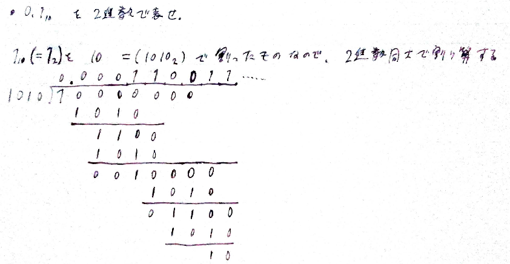
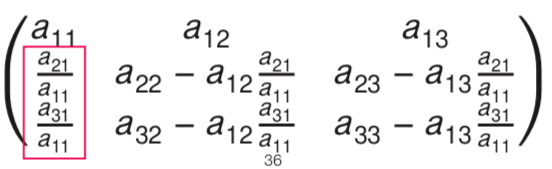
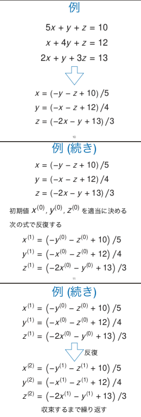
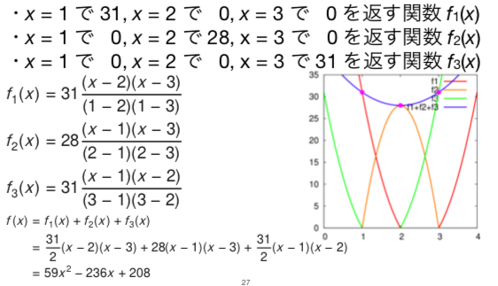
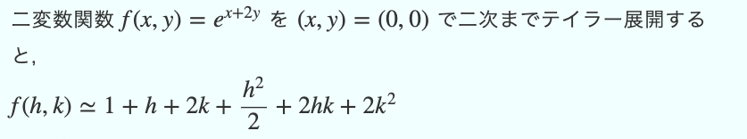

# 数値計算

- 数値計算と誤差
  - 0.1を2進数にする方法
    - 
- 非線形方程式の解法
  - ニュートン法
    - 2次収束
      - 誤差の2乗に比例して収束する
    - `x_{n+1} = x_{n} f(x)/f'(x)`
  - 割線法
    - ニュートン法の微分の所を、微分の小さいhの式で近似する
    - 1.6次収束
  - 二分法
    - 解を挟むように2個決める(a,b)
      - このとき `f(a)*f(b)<0` になるように
    - c = (a+b)/2 として、f(c)を求める
    - `f(a)*f(c), f(b)*f(c)` のうち、海を挟んだほう(=負の方)を使う。使わなかった方はcで更新
    - 1次の速さで収束
      - 半分ずつになっていく
- 連立一次方程式の解法
  - ガウスジョルダン法
    - いつもやってるやつ
    - ピボット選択をする
      - 0割りと、情報落ちを防ぐため
      - 列の絶対値最大要素を一番上に持ってくる
  - LU分解
    - `Ax= B`で、Bがコロコロ変わる時に有効
    - `A = LU`と分解する
      - Lは、対角成分全部1の下三角行列
      - Uは、普通の上三角行列
    - この図のように分解していく
      - 
    - 分解後は、`Ly = b`を解いてyを求める
      - Lは対角成分1の下三角だから、前進代入(上から下へ計算)すると簡単に解ける
    - `Ux = y`を解いてxを求めて、おわり。
      - Uは上三角だから、後退代入(下から上へ計算)すると簡単に求まる
  - ヤコビ法
    - 厳密解は求まらない。何度も繰り返すと近づく系の手法(反復解法)
    - こんなかんじ
      - 
    - 疎行列だとうれしい
  - ガウスザイデル法
    - ヤコビ法とほぼ一緒
    - `x_n`から`x_{n+1}`を求めた後、`y_{n+1}`を求める時に、直前に計算した`x_{n+1}`をすぐさま利用する。だけ。
    - 並列計算出来ない
  - SOR法
    - ガウスザイデルをちょっと改良。省略...
  - 共役勾配法(CG法)
    - ムズいから省略~
- 近似と補間
  - 最小二乗近似
    - ちょっと馴染みあるあれ。
    - 多項式で近似する
    - 各点yと近似式f(x)の差の総和`Σ (yf(x))^2`を最小化する
    - これは2次関数だから、微分した式が0になるように。
    - 計算は長くて大変
  - ラグランジュ補間
    - わかりやすくて面白かったやつ
    - 
  - スプライン補間
    - 2点を3次多項式で表す
    - 5点あったら、2点間の4式 + 端の2式 = 6式 作る
      - 端は1次式
      - てきとーに3次式の係数をおいて6式つくる。微分、微分微分する。
      - で、隣り合う式同士で、代入した値を合わせて係数を求める
- 数値積分
  - 台形則
    - 2点間を台形で近似
    - `S = Σ{ h * (f(x_i)+f(x_{i+1})/2 }`
  - シンプトン則
    - 3点間を2時間数で補間
    - `S = h/3 * ( fx0 + 4fx1 + 2fx2 + 4fx3 + 2fx4 + ... + fxn )`
      - 1,4,2,4,2,...,1 って係数がなってる
  - ニュートンコーツの公式
    - 一般化したやつ。ムズい。
- 常微分方程式の解法
  - オイラー法
    - 1回微分方程式に使う
    - 時間tと距離xの関数式`F(t,x) = 0`(陰関数)を考える
      - tとxの関係式をdxとか使わずに求めるのが数学での目的
        - すると、tからxが求まる。
      - だけど、計算機で不定積分は出来ない
      - ので、tからxを数値計算で求める
    - dx/dt = f(x,t)
      - fはxとtの関数
    - 刻み幅hは自由に決める
    - `x_{n+1} = x_n + hf(t_n,x_n)`で順に求める
      - xは計算で順に求まって、tはそもそもtからxを求めたかった変数なんだから既知。
    - 1次の精度
      - hを1/2にすると誤差も1/2になる
      - 計算時間N倍だけど誤差1/Nは、、、微妙かもしれない
  - ホイン法
    - 更新の仕方
      - `k_1 = hf(x_n, t_n)` オイラー法と同じ
      - `k_2 = hf(x_n + k_1, t_n + h)` もう1ステップ先も求める
      - `x_{n+1} = x_n + (k_1 + k_2)/2` で、その中間を更新に使う
    - 2次精度
    - 2次のルンゲクッタ法でもある
  - ルンゲクッタ法
    - 4次精度
    - めっっちゃむずいらしい
- そのた
  - 2変数関数のテイラー展開
    - 
