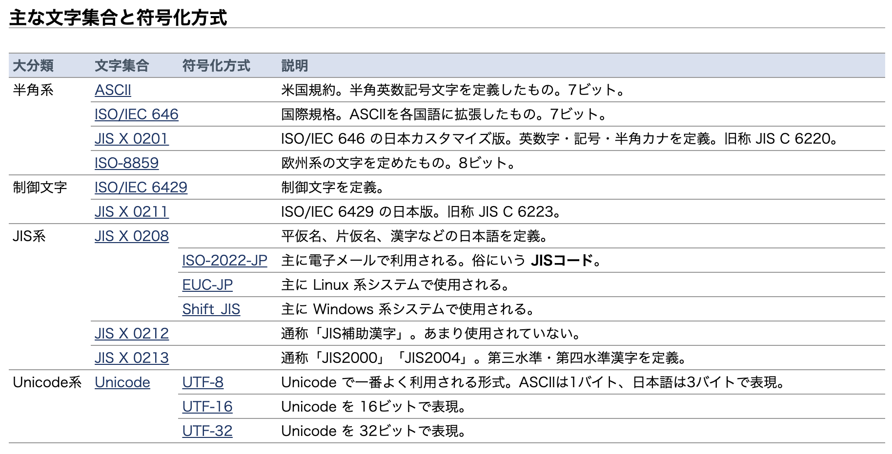

# 文字コード

- SoftwareDesign 2016年12号より
  - 符号化文字集合
    - 利用する文字集合自体を定めたもの
  - 文字符号化方式
    - その定めた文字をどう表現するかについて定めたもの
  - 符号化文字集合と文字符号化方式の両方をいっぺんに定めているものもある
    - ASCIIとか
  - [とほほの文字コード入門](https://www.tohoho-web.com/ex/charset.html)
    - []
  - 文字コード
    - ASCII
      - 符号化文字集合と文字符号化方式
      - いわゆる半角英数字記号
      - 7bitで表現
    - Unicode
      - 符号化文字集合
      - 合字、絵文字とかも入っている
      - 4byte
    - EUC-JP
      - 符号化文字集合の組み合わせと文字符号化方式
      - Extented Unix Code
      - JPとついているのは日本語用だから
      - いくつかの漢字を含んだ符号化文字集合を組み合わせて表現する
      - 自身はEUC-JPだ! という情報を自身ではもっていない
      - 日本語以外の言語(ロシア語とか)を含めることができない
    - Shift_JIS
      - 符号化文字集合の組み合わせと文字符号化方式
      - 2バイトで表現する文字の2バイト目にASCIIでの制御文字で使われているコードが割り当てられていることもあるから誤動作しやすい
    - UTF-16
      - Unicode用の文字符号化方式
      - 1文字を2 or 4byteで表現
      - エンディアンをビッグにするかリトルにするかを先頭BOMで指定できる
    - UTF-8
      - Unicode用の文字符号化方式
      - 1文字を1~4byteで表現
      - ASCIIに入っている文字に関してはASCIIと同じ符号化
      - 2~4byteで表現する文字のコードにはASCIIでの特殊文字のコードは含まれていないから安全
  - Rubyと文字コード
    - `String#dncodein`
    - `__ENCODEING__`
    - `# codeing: `
    - IOは、内部エンコーディングと外部エンコーディングをもっている
      - 外部エンコーディング：ファイルの中身がどんなエンコーディングかの情報
      - 内部エンコーディング：ファイルをどんなエンコーディングで読み込んで扱うかの情報
      - [class IO (Ruby 3.0.0 リファレンスマニュアル)](https://docs.ruby-lang.org/ja/latest/class/IO.html)
**エンコーディングの変換が行われるかどうか**

| | バイナリ読み込みメソッド | テキスト読み込みメソッド | 書き込みメソッド |
| --- | --- | --- | --- |
| 指定無し | X | X | X |
| 外部エンコーディングのみ | X | X | O |
| default_internalのみ | X | O | O |
| 内部エンコーディングのみ | X | O | O |
| 外部エンコーディングと内部エンコーディング | X | O | O |
| 外部エンコーディングとdefault_internal | X | O | O |

- MySQLと文字コード
  - charsetとcollationの指定がある
  - charsetは文字コードについて
  - collationは文字の比較について
  - charset
    - サーバー、データベース、テーブル、カラムごとにつけられる。サーバーにつけるだけで十分
    - utf8mb4を指定すべし
    - クライアントから接続するときに、クライアント側でもどのcharsetで受け取るかの指定が必要なので注意
  - collation
    - 照合順序、照合規則
    - utf8mb4のデフォルトはutf8mb4_general_ci
    - utf8mb4_binがよさそう?
    - [MySQL 8.0 でも utf8mb4_general_ci を使い続けたい僕らは - mita2 database life](https://mita2db.hateblo.jp/entry/2020/12/07/000000)

**イコール判定**

| | A==a | はは==ぱぱ | 🍣==🍺 | ＋==+ |
| --- | --- | --- | --- | --- |
| utf8mb4_general_ci | T | F | T | F |
| utf8mb4_bin | F | F | F | F |
| utf8mb4_unicode_ci | T | T | T | T |
| utf8mb4_unicode_520_ci | T | T | F | T |

- ASCIIのhex（16進数値）
  - [IT - ASCIIコード表](http://www.dojeun.com/contentsview.php?listid=00016)
- `\n`と`\r\n`の違い
  - https://ja.wikipedia.org/wiki/改行コード
  - CR：キャリッジリターン
  - LF：ラインフィード
  - どちらも制御文字
  - > コンピュータでは、同じ文字コードを使用していても、改行コードは異なる場合があるため、異なるシステム間でのデータの際には、改行が正確に反映されない場合がある。
- 文字コード（符号化文字集合と文字符号化方式）を合わせて、かつ改行コードも合わせることでやっと正しく文字のやり取りができる
  - > ASCII文字コードに基づくシステムでは、CR（復帰、0D(16進)）、LF（改行、0A(16進)）、またはCR+LFで表している。
  - > Unicodeでは、CR (U+000D) とLF (U+000A) に加えて、「次の行」 (next line) を示すNEL (U+0085)、行区切り文字 (line separator) を示すLS (U+2028)、段落区切り文字 (paragraph separator) を示すPS (U+2029) が提供される。
- 「文字数」の数え方は単位によって変わり、同じ文字列なら「書記素 ≤ コードポイント ≤ UTF-16 単位 ≤ UTF-8 バイト」になる
  - コードポイント：Unicode が文字ごとに割り振った番号（「𠮷」は `U+20BB7`。[Unicode Glossary「Code Point」](https://www.unicode.org/glossary/#code_point)）
  - 書記素（見た目上の1文字）：`👨‍👩‍👧` は 👨、ZWJ、👩、ZWJ、👧 の5コードポイント
  - UTF-16 単位：`U+FFFF` を超える文字（𠮷や絵文字）は2単位（サロゲートペア）になる
  - UTF-8 バイト：ひらがなや漢字の多くは3バイト、𠮷や絵文字は4バイト
  - 普通の日本語は書記素、コードポイント、UTF-16 単位で差が出ない。差が出るのは絵文字や一部の漢字、結合文字
- 言語やDBごとの数え方
  - Java、JavaScript、C# の文字列の長さは UTF-16 単位（[Java String#length](https://docs.oracle.com/javase/8/docs/api/java/lang/String.html#length--)、[MDN: String.length](https://developer.mozilla.org/ja/docs/Web/JavaScript/Reference/Global_Objects/String/length)、[.NET String.Length](https://learn.microsoft.com/ja-jp/dotnet/api/system.string.length)）
    - JavaScript の `"𠮷👨‍👩‍👧"` は、`s.length` が10、`[...s].length`（コードポイント数）が6
  - Python の `len` と、MySQL や PostgreSQL の `VARCHAR(n)` はコードポイント（[Python「テキストシーケンス型」](https://docs.python.org/ja/3/library/stdtypes.html#text-sequence-type-str)、[MySQL 8.0「The CHAR and VARCHAR Types」](https://dev.mysql.com/doc/refman/8.0/en/char.html)、[PostgreSQL「文字型」](https://www.postgresql.org/docs/current/datatype-character.html)）
- 他システムの文字数上限に合わせて切り詰めるとき
  - 相手の単位がわからなければ、厳しいほうの単位（UTF-16 単位など）で収める
  - UTF-16 単位で単純に切ると（`s.slice(0, n)`）、サロゲートペアの片割れが残ることがある。コードポイント単位で数えて切る
  - JSON にエスケープすると文字数が増えるので、相手がエスケープの前と後のどちらで数えるかを確かめる
