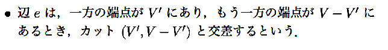
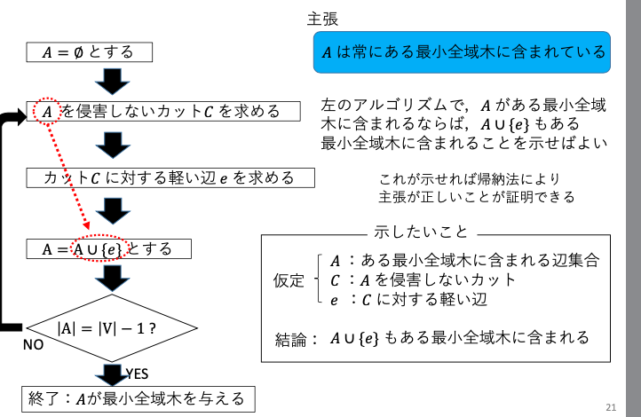

# 最小全域木

- アサイクリックグラフ
    - 閉路を持たないグラフのこと
      - 連結なら木
  - 最小全域木
    - 全域木のうち、辺の重みの総和が最小のもの
    - 一意に定まらないこともある
  - カット
    - グラフを真っ二つにする
    - 片方が空なのはNG
    - 
  - 最小全域木を求める方法
    - 
  - カットに対する軽い辺
    - カットと交差する辺のうち、最もコストが小さいもの
  - 最小全域木を求める方法の証明
  - 同型グラフだとしても、特に指定がなければ別物?
