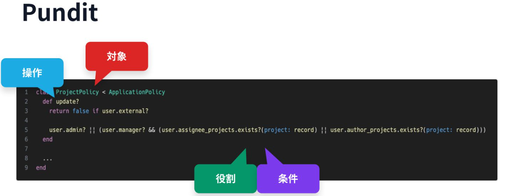
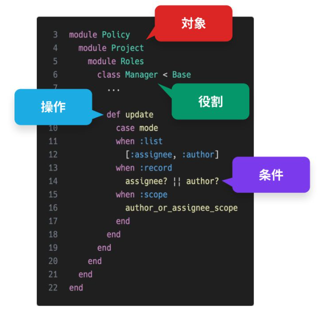
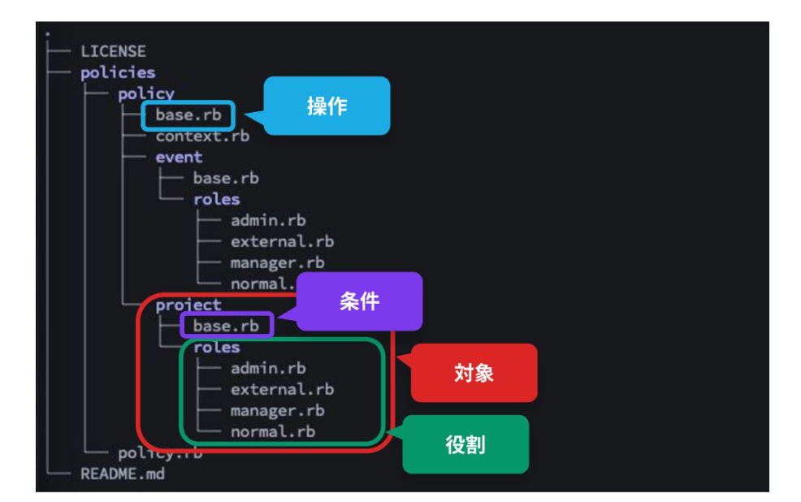

# 権限管理

- [「技術負債にならない・間違えない」 権限管理の設計と実装 - Speaker Deck](https://speakerdeck.com/naro143/ji-shu-fu-zhai-ninaranaijian-wei-enai-quan-xian-guan-li-noshe-ji-toshi-zhuang?slide=39)
  - RBAC （role-based access control）
    - **役割**に応じた権限管理
  - ABAC（Attribute-Based Access Control）
    - **条件**（役割以外）に応じた権限管理
  - たとえば「プロジェクトの更新は管理者か担当者ならできる」という権限管理を抽象化すると
    - 「**対象**の**操作**は**役割**か**条件**ならできる」
    - 「**Model** の **CRUD** は **Role** か **Scope** ならできる」
  - punditの場合
    - 
    - 役割と条件が一緒の箇所に置かれているところがイマイチ
  - このスライドでは、役割と条件を分離して書けるような拡張を導入
    -  
    - フロント側にもマスタデータ的にこれを返すことで、フロントのUI制御でも同じように使えている
