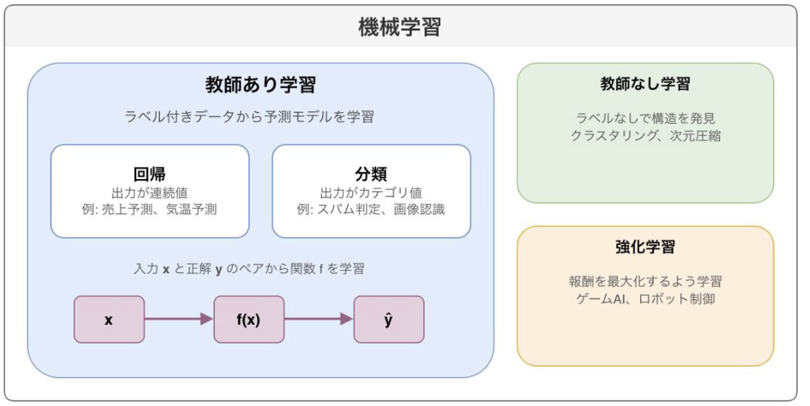
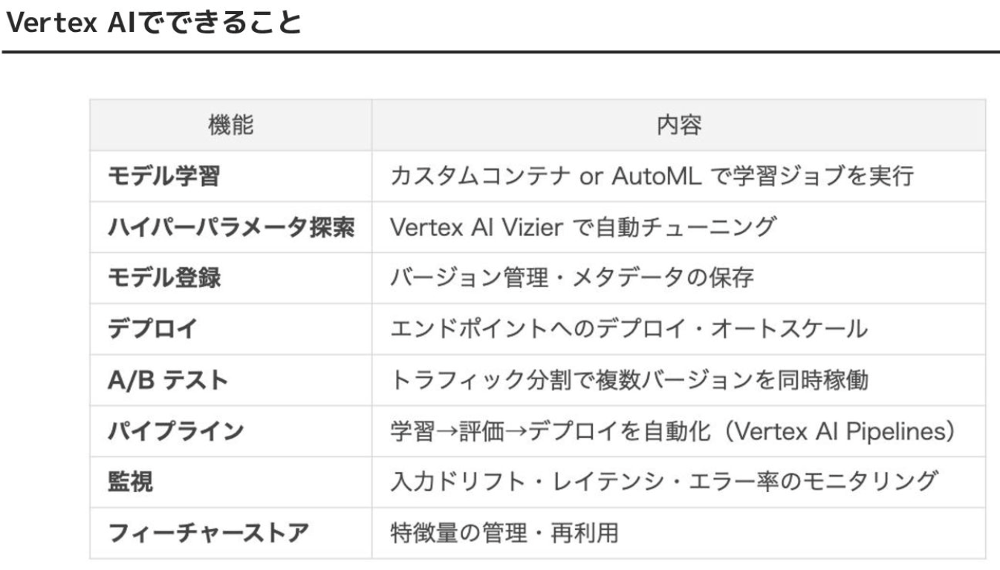

# 機械学習の基礎とMLOps

[AI研修(Day1)【MIXI 26新卒技術研修】 - Speaker Deck](https://speakerdeck.com/mixi_engineers/2026_new_grad_training_ai_day1)

- day1
  - 1. 機械学習（ML）基礎
    - 
    - 教師あり学習
      - 分類 (classification) と回帰 (regression)
        - 分類：出力が離散値
        - 回帰：出力が連続値
    - 教師なし学習
      - 次元削減
        - 構造が不明な（ラベル付けされていない）データを扱い、データ内のパターンを見つける学習
    - 強化学習
      - 報酬を受取りながら学習を進める
  - 2. MLモデルの推論
    - 3段階のフェーズがある
      - 前処理(preprocess)
        - 入力をテンソル(tensor)(多次元配列)に変換する
      - モデル計算(model inference)
        - tensorをモデルに入れて、出力tensorを得る
      - 後処理(postprocess)
        - 出力tensorを、タスクに適した形にデコード
    - 「テーブルデータ」「自然言語処理」「画像処理」「音声処理」それぞれについての↑の手法が紹介されているが、省略
    - モデルの性能を評価するにあたって適切な手法を選ぶのが大事
  - 3. MLモデルの学習
    - 「訓練データ」「検証データ」「テストデータ」の3種類必要
    - 過学習を防ぐ色々な工夫(手法)がある
    - ドメイン適用：学習済みモデルの一部を利用して、追加で解きたいタスクの学習をさせること
      - 手法
        - 転移学習(transfer learning)
          - 追加した層の重みのみ更新する（学習にかかるコスト少なめ）
          - 出力形式が変わる場合はこっち
        - ファインチューニング(fine-tuning)
          - 全てのパラメーターの重みを更新する
          - 出力形式が変らない場合にはこっち
  - 4. MLモデルの評価
  - 5. MLモデルの高速化
  - 6. MLモデルのデプロイ・運用
    - MLOpsとは：開発・デプロイ・モニタリングまでのMLのライフサイクルの管理
      - テスト追跡
        - テストと結果を追跡して最適なモデルを特定する
      - モデルのデプロイ
        - 本番環境にモデルをデプロイして、アプリケーションからアクセスできるようにする
      - モデルのモニタリング
        - モデルをモニタリングして、パフォーマンスの問題や低下を検出する
      - モデルの再トレーニング
        - 新しいデータでモデルを再トレーニングしてパフォーマンスを改善する
    - Vertex AI
      - GCPが提供するMLプラットフォーム
      - MLOpsに必要なものを提供している
      - 
  - 7. まとめ
