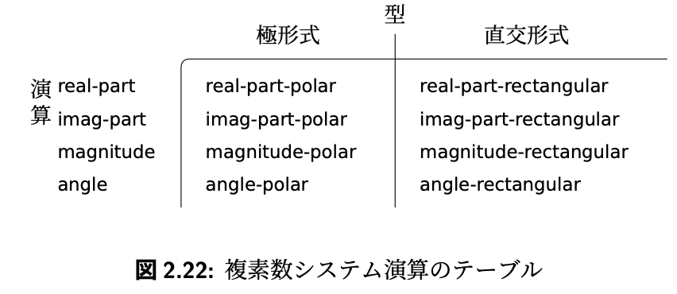

# 計算機プログラムの構造と解釈

- https://sourceacademy.org/sicpjs/index
- **1 Building Abstractions with Functions 1**
- **1.1 The Elements of Programming 3**
  - 正規順序評価
    - normal-order evaluation
    - 完全に展開してから簡約する
  - 適用順序評価
    - applicative-order evaluation
    - 引数を評価してから適用する
      - 一般的
    - (置換モデル下において)正規順序評価と適用順序評価は同じ値になる
  - and, or は特殊形式
- **1.2 Functions and the Processes They Generate 26**
  - 再帰プロセス
    - recursive process
    - 普通の再帰
    - 再帰の展開が伸び縮みする
    - 線形再帰プロセス
      - 伸び縮みの増加(情報の量)とステップ数が線形に増えるもの
  - 反復プロセス
    - iterative process
    - 末尾再帰のあれ
    - 再帰の展開が固定の長さ
    - 線形反復プロセス
      - 必要なステップ数が線形に伸びるもの
        - factorialとか？
        - フィボナッチ数列とかは違いそう
          - 多重再帰という？
            - https://qiita.com/pebblip/items/cf8d3230969b2f6b3132#多重再帰
  - 増加オーダー
    - order of growth
    - 大きさ n の問題についてプロ セスが必要とするリソースの量を R(n)
  - 線形反復にすると、空間がθ(1)で済む
- ---
  - お釣りの計算 Example: Counting change
- ---
- **1.3 Formulating Abstractions with Higher-Order Functions 48**
  - 不動点
    - fixed point
    - >数値 x が方程式 f(x) = x を満たすとき、x は関数 f の 不動点
    - `cos(cos(cos(cos(cos(cos(1))))))`を計算すればcosの不動点が求まる(約0.73)
      - 関数が吸引的なときのみ
      - 不動点が存在しない関数もある
    - 求めた解が振動するときは、その平均を使って再計算するとよい
- **2 Building Abstractions with Data 69**
  - 複合データ
    - compound data
    - >プログラムを設計する概念レベルを 引き上げ、設計のモジュール性を高め、言語の表現力を強くしたい
  - 異なるデータ型を処理するジェネリック演算
    - generic operation
  - データ主導プログラミング
    - data-directed programming
  - >複合データを扱ううえで鍵となる考え方のひとつは、クロー ジャ (closure) という概念です。
- **2.1 Introduction to Data Abstraction 72**
  - ラムダによるconsリスト
    - ラムダ計算っぽい
```lisp
(define (cons x y) (lambda (m) (m x y)))
(define (car z)

(z (lambda (p q) p)))

```

- **2.2 Hierarchical Data and the Closure Property 84**
  - 2.2.3 Sequences as Conventional Interfaces
    - conventional interfaces
      - 従来のインターフェース?
    - `sum_odd_squares`
    - `even_fibs`
    - ↑シグナルの流れ、として見れば似ている
      - enuumerate -> map -> filter -> accumulate
    - Sequence Operations
    - signal-flow structure
      - シグナルのリストとして見るのが鍵
    - `enumerate_interval`
      - 数値をlistにする
    - `enumerate_tree`
      - treeをlistにする
        - (使われている関数を再掲したほうがいいかも)
  - sequence (ここではlistとして実装) は、便利なインターフェース
    - combineモジュール
- **2.3 Symbolic Data 124**
- **2.4 Multiple Representations for Abstract Data 147**
- >この節では、プログラムの部品によって違う方法で表現されるデータを 扱うやり方について学びます。そのためには、ジェネリック手続き (generic procedure)— 二種類以上の方法で表現されるデータを扱える手続き—を構築す る必要があります。ジェネリック手続きを構築するためにここで使う主なテク ニックは、タイプタグ (type tag) を持つデータオブジェクト、つまりどのよう に処理されるべきかという情報を明示的に持っているデータオブジェクトを使 うということです。また、データ主導 (data-directed) プログラミングについて も検討します。これは、ジェネリック演算によって加法的にシステムを組み立 てていくための強力で便利な実装戦略です。
  - 複素数は直交形式と極座標の二通りで表すことができる
    - 透過的に扱いたい→データ抽象化戦略
  - 型によるディスパ ッチ (dispatching on type)
    - データの型をチェックし適切な手続きを呼ぶこと
    - 弱点
      - 手続き**が**、すべてのtypeについて知っていなければならない
        - このテクニックが加法的 (additive) でないから
      - → データ主導プログラミングによって解決できる
        - >ここで、システム設計をさらにモジュール化するための手段が必要になり ます。データ主導プログラミング (data-directed programming) として知られる プログラミングテクニックはその手段を提供してくれます。
        - data-directed programming
- 
  - ↑のテーブルをグローバルに持っておいて、このテーブルに手続きをput,getすることで実現できる
  - >もうひとつの実装戦略は、テーブルを列に分解し、データ型によってディ スパッチを行う “賢い演算” を使うのではなく、**演算の名前によってディスパ ッチを行う** “賢いデータオブジェクト” を使うというものです
    - >このプログラミングスタイルはメッセージパッシング (message passing) と 呼ばれています。この名前は、データオブジェクトは要求された演算の名前を “メッセージ” として受け取る実体であるというイメージから来ています。
    - オブジェクトが、自身に関する手続きを持っているスタイル
- **2.5 Systems with Generic Operations 163**
  - ジェネリック演算によるシステム
  - クロスタイプ演算
    - 有理数と複素数の加算とか
    - 手続きをどこにもつか問題
      - 有理数パッケージにもつか複素数パッケージにもつか、あるいは新しいパッケージを作るか
      - 強制型変換によって、ある程度解決する
    - 二つの型の名前をキーとして、型変換手続きをテーブルに登録する
      - >うまくやると、普通は n^2よりも少ない数の強制型変換手続きで済ませることができます
        - 型を経由することで変換できる
        - 型変換のグラフ作りが必要
          - 経路が複数あるときにどうするんだろう
- **3 Modularity, Objects, and State 189**
- **3.1 Assignment and Local State 190**
- **3.2 The Environment Model of Evaluation 206**
- **3.3 Modeling with Mutable Data 222**
- **3.4 Concurrency: Time Is of the Essence 263**
- **3.5 Streams 280**
- **4 Metalinguistic Abstraction 317**
- **4.1 The Metacircular Evaluator 319**
- **4.2 Lazy Evaluation 360**
- **4.3 Nondeterministic Computing 373**
- **4.4 Logic Programming 398**
- **5 Computing with Register Machines 449**
- **5.1 Designing Register Machines 450**
- **5.2 A Register-Machine Simulator 468**
- **5.3 Storage Allocation and Garbage Collection 487**
- **5.4 The Explicit-Control Evaluator 499**
- **5.5 Compilation 519**
