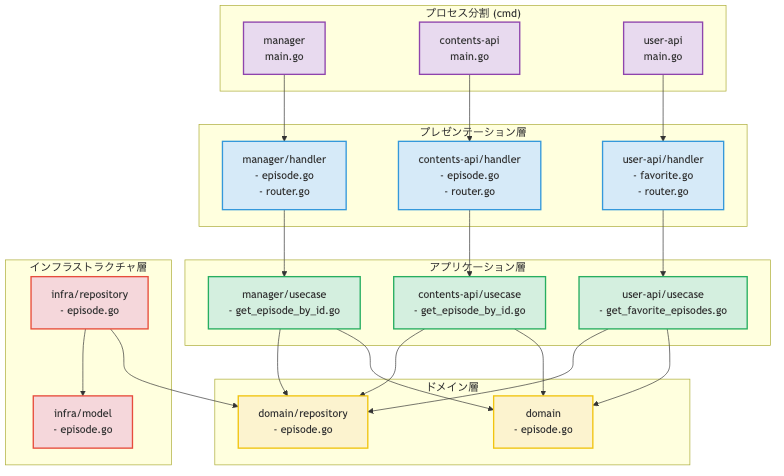

# 設計

- [君の継承の使い方は間違っている - Qiita](https://qiita.com/tonluqclml/items/c0110098722763caa556)
  - 継承
  - 悪い継承
    - メソッド共有のための継承
      - >単にクラス間で処理を共有したいだけなら、適当な別クラスを作って static メソッドを定義しましょう。
    - メンバ変数の共有のための継承
    - 機能追加・機能変更のための継承
  - 良い継承
    - インターフェースの継承（implements継承）
    - Template Method パターン
- [労務ドメインの面白さ（届出書類機能編） - SmartHR Tech Blog](https://tech.smarthr.jp/entry/2024/12/06/161613#fnref:1)
  - 懐かしい感じ
- [医療AIスタートアップの一人目エンジニア始めました](https://zenn.dev/medicu/articles/4d8234762c0696)
  -  とwebの比較
- [決済システムの残高管理周りの DB 設計と戦略 - カンム テックブログ](https://tech.kanmu.co.jp/entry/2021/06/29/131649)
  - > 残高を管理するテーブルを持たず、これらイベントの履歴のみで残高を管理しています
  - > 本記事のポイントは
    - >残高を管理をするテーブルは作らず、トランザクション履歴のsumで都度残高を算出している
    - >そのクエリは遅くなるのでは？とよく言われますがそんなことはない、雰囲気で判断するのではなく実行計画とベンチマークで判断しましょう
    - >とはいいつつデータ量が増えたときの戦略を考案しておきましょう
  - スナップショットテーブルとトランザクションテーブルを使って算出する
- [アプリケーションアーキテクチャをいい感じに検証し続けたい話 - CADDi Tech Blog](https://caddi.tech/2025/04/16/093000)
  - (javaの)ArchUnitというソフトウェアを使って、アーキテクチャが正しいかどうかの静的解析を導入した
  - 設計方針の仕組み化
- [TVerバックエンドAPIのリアーキテクチャ - TVer Tech Blog](https://techblog.tver.co.jp/entry/api-rearchitecture)
  - 目的
    - サーバーのスループット向上（高負荷時の耐性向上）
    - キャッシュ戦略の見直し（アプリ層のキャッシュを削減し、CDNを活用）
    - 開発生産性の向上（コードのテスト容易性と可読性を改善）
  - ビジネスロジックが書かれたコードが肥大化しているという大きな負債があった
  - オニオンアーキテクチャの採用
    - アクセス特性ごとに異なるAPIプロセス(= サーバー)に分割
    - マイクロサービスにはしなかった
      - サービス間通信が発生するので移行が大変で、開発リソース的に厳しかったため
  - 
    - ファイル名とか、DDDをクリーンアーキテクチャでやるときの参考になる
  - User Interface層(Presentation層) ↔ Usecase層 間は同じ型でやった
  - DomainServiceの導入はしなかった
    - > Domain層でのモデルとビジネスロジックの表現として、DomainServiceを導入することは初期にはやらないこととする
    - > 開発者ごとの解釈によって概念の捉え方に幅が生まれやすく、肥大化やドメインモデル貧血症を招く恐れがある
    - > まずはビジネスロジックをDomain層に凝集させていくことを優先する
- 技術駆動パッケージング
  - アンチパターン
  - エンティティ・コントローラー・サービス などごとにディレクトリを切るディレクトリ設計のこと
  - [Xユーザーのミノ駆動さん: 「右(2枚目)は「技術駆動パッケージング」というアンチパターン。設計パターンごとにまとめるのは一見綺麗に整頓されているように見えるが、ドメインの関心事が設計パターンで分断されてしまい、業務概念ごとにまとまるべきものが低凝集になってしまう。特にマイクロサービス化を試みる場合非常に困る。」 / X](https://x.com/MinoDriven/status/1148960876201836546)
    - クリーンアーキテクチャ5章の「インフラストラクチャ駆動パッケージングの落とし穴」にも記載があるとのこと
