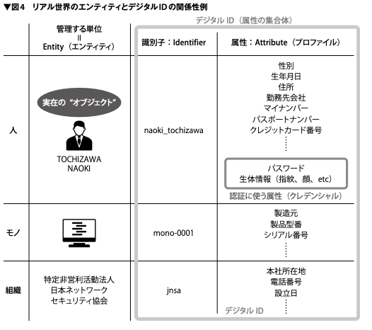
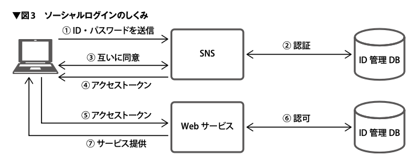
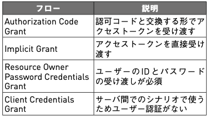

# 認可

- SAMLとOAuth
  - SAMLは認証
  - OAuthは認可
- **「今さら聞けない認証・認可」**
- software design 2020年11月号より
- 
  - 識別(Identification)→認証(Authentication)→認可(Authorization)
  - ロール
    - どのサービスに対してどのようなパーミッションを与えるか(= ポリシー)を定義
  - ロールベースアクセス制御 (RBAC)
  - クレデンシャルの特性
    - ユーザーの記憶によるもの
    - ユーザーが所持しているもの
    - ユーザーの身体的な特徴に基づくもの
  - ↑の組み合わせが「[多要素認証](二要素認証)」
  - ソーシャルログイン
    - 認証と認可を分離できる
- 
  - [FIDO](ファイド) 認証
    - Fast IDentity Online
    - しくみ
      - ユーザーは秘密鍵を持っている
      - ユーザーはFIDO認証サーバーから届いた「チャレンジ」に署名する
      - FIDOサーバーは、(予め登録されている)公開鍵でそのチャレンジを検証
  - OAuth
    - Open Authorization
    - RFC 6749 にて OAuth 2.0 の 4 種類の認可フローが定義されている
      - 
