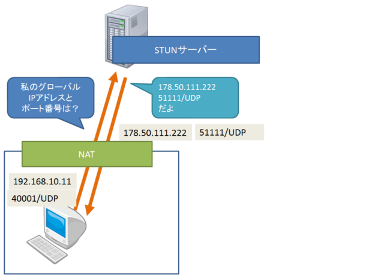
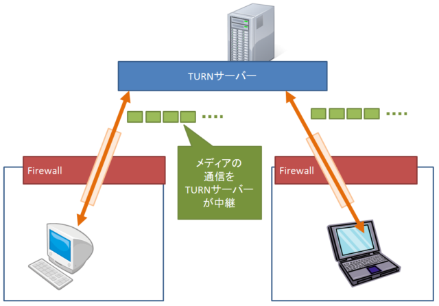

# 連載 | WebRTC入門2016 | HTML5Experts.jp

- [連載 | WebRTC入門2016 | HTML5Experts.jp](https://html5experts.jp/series/webrtc2016/)
  - カメラを使ってみよう
    - WebRTCとは
      - Web Real-Time Communication
      - Webブラウザ上でビデオ/オーディオの通信や、データ通信を行うための規格
    - できること
      - カメラ、マイクといったデバイスへのアクセス
      - ビデオ/オーディオ/データ通信
      - ビデオ/オーディオの録画/録音
    - 使い方
      - `navigator.mediaDevices.getUserMedia(constraints) // => Promise<MediaStream>`
        - `MediaStream`は、HTMLの`<video>`要素に割り当てることができる
        - PCのカメラやマイクを得れる
  - 手動でWebRTCの通信をつなげよう
    - RTCPeerConnection
      - インターフェース
        - > WebRTCでは、映像/音声/アプリケーションデータなどをリアルタイムにブラウザ間で送受信することができます。それをつかさどるのが「RTCPeerConnection」です。
      - 特徴
        - Peer-to-Peer(P2P)の通信 → **ブラウザとブラウザの間で直接通信する**
        - UDP/IPを使用 → TCP/IPのようにパケットの到着は保障しないが、オーバーヘッドが少ない
          - UDPのポートは動的に自動で選ばれる
        - PeerとPeerの間で暗号化通信を行う → P2P通信の前に鍵の交換を行う
      - P2P通信を確立するまで
        - やり取りする情報（やりとりのことを「シグナリング」という）
          - Session Description Protocol (SDP)
            - 各ブラウザが通信した内容を示す
            - 中身：通信するメディアの種類（音声、映像）、メディアの形式（コーデック）、アプリケーションデータ、IPアドレス、ポート番号、暗号化の鍵
          - ICE: Interactive Connectivity Establishment
            - P2P通信を行う際の経路を定めるしくみ
          - ICE Candidate
            - ICEの候補のこと
          - > 候補が見つかったら順次通信を試み、最初につながった経路が採用されます
      - ↑のシグナリングのやり方は特に決められておらず、自由な方法を使える
        - （記事にはコード例載っているが省略）
        - `new RTCPeerConnection({"iceServers":[]})`
          - `.onicecandidate=`
          - `.createOffer()`
          - `.setLocalDescription(sessionDescription)`
          - `.createAnswer()`
          - `.addStream(stream)`：送信する映像/音声ストリームを指定
      - SDPの抜粋
        - SDPの中にICE Candidateの情報も含まれている
          - `a=candidate:` で始まる行はICE candidate (ICE接続する経路の候補)
```sdp
m=video 58461 UDP/TLS/RTP/SAVPF 100 101 116 117 96 97 98
c=IN IP4 192.168.xxx.xxx
a=rtcp:58465 IN IP4 192.168.xxx.xxx
a=candidate:2999745851 1 udp 2122260223 192.168.xxx.xxx 58461 typ host generation 0 network-id 4
a=candidate:2747735740 1 udp 2122194687 192.168.xxx.xxx 58462 typ host generation 0 network-id 3
a=candidate:1606961068 1 udp 2122129151 10.2.xxx.xxx 58463 typ host generation 0 network-id 2
...    
a=candidate:453808805 2 tcp 1518083838 192.168.xxx.xxx 9 typ host tcptype active generation 0 network-id 1
a=ice-ufrag:xxxxxxxxxxxxx
a=ice-pwd:xxxxxxxxxxxx
```

- SDPには 通信を始める側(Offer)と、通信を受け入れる側(Answer) があり、Offer → Answerの順番でやりとりする
- シグナリングサーバーを動かそう
  - （この文脈における）シグナリングサーバーとは：↑の SDP と ICE candidate を仲介するサーバー
  - websocket接続でシンプルなシグナリングサーバーを立ち上げていた
- シグナリングを拡張して、複数人で通信してみよう
  - 複数人それぞれで相互に接続する必要がある（ので、人数増えると大変）
  - 
  - やりかた自体は力技で複数接続を確立させればよい
- Firebaseで楽々シグナリング
- そして壁の向こうへ。
  - NAT越え
    - NATを越えてPeer-to-Peer通信を行うには、シグナリング処理でお互いに自分の知らないグローバルの情報（自身のグローバルIPアドレスや、グローバルUDPポート）を交換する必要がある
      - → STUNに問い合わせて知る
  - STUN (Session Traversal Utilities for NATs)
    - STUNサーバー：NATで変換されたIPアドレス/ポートを教えあげるサーバー（仕組みはシンプル）
      - Googleが公開してくれている (`stun.l.google.com:19302` など)
    - 
  - TURN (Traversal Using Relays around NAT)
    - NAT超えができたところで、Peer-to-Peer通信に使う自身のポート自体が、自身のファイアウォールに塞がれている可能性がある（特に企業ネットワークなど）
    - TURNというしくみを使うことで、それを解決できる
      - TURNサーバーが、パケットをそのまま転送するしくみ
        - `80/TCP` ポートを使うように設定することで、ファイアウォールに阻まれずに済む
    - 
