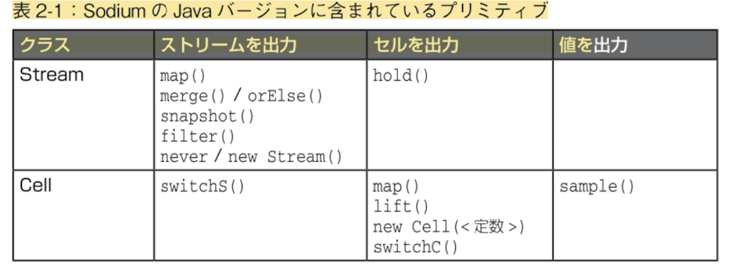
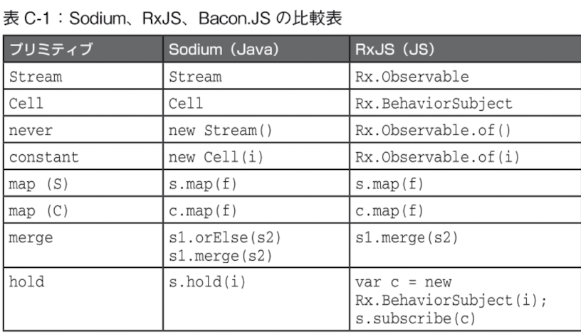
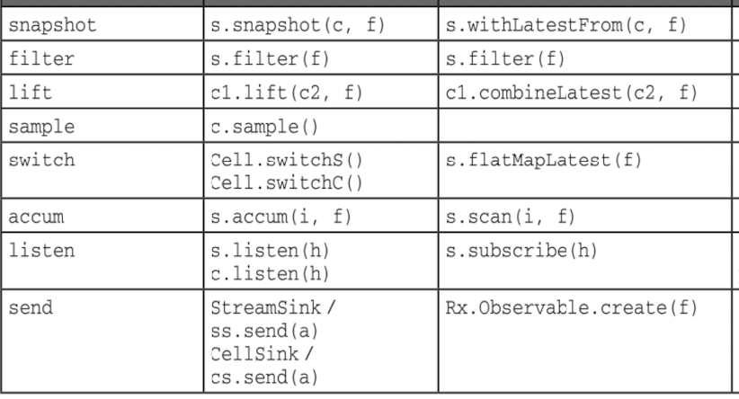

# 関数型リアクティブプログラミング


## 第1章　眼だけではなく、手も使おう

- > FRP は標準的なプログラミング言語で書かれた単純なライブラリとして提供され、Observer パターンのリスナーを置き換える

## 第2章　FRPの基本原理

- 出てくる図とその意味
  - 矢印：ストリーム
    - 「状態の変化」を表す
    - プログラム中では`Stream<A>`型の値として出てくる
  - ボックス：ストリームの変換
    - プログラム中では関数として出てくる
  - 矢じり付きの直線：セル
    - 「状態」を表す
    - プログラム中では`Cell<A>`型の値として出てくる
- FPRの処理はすべてトランザクション内（トランザクション型のコンテキスト）で行われる
- `map: (S) -> (S)`
- `merge: (S, S, F) -> (S)`
  - Sodiumだと`s1.orElse(s2)`もしくは`s1.merge(s2, combine_function)`
    - このcombine_functionは、同時イベントが起きたときのみこの関数が使われる
    - orElseの場合はs1側が優先される
- `hold: (S, init) -> C`：状態をセルに保存する
- `snapshot: (Stream<A>, Cell<B>, F) -> Stream<C>`：ストリームイベントをきっかけにして、セルから値を取り出す
  - Fは`F: (A, B) -> C` という型で、出力ストリームの中身を指定するための関数
  - Sodiumでは`s.snapshot(c, f)`
- 前方参照
  - 文字列上でプログラムを定義する以上、後に定義する値を先に使うことはできない
    - 図でいうと、閉路がある状態
  - そいういうときは`CellLoop`型（ストリームの場合は`StreamLoop`型）の値と、`loop`関数をつかって記述する
```java
// 以下のプログラムでは value と sUpdate が循環参照している（ので、素直には書けない）
// 中身は空でとりあえず作成
CellLoop<Integer> value = new CellLoop<>();
// それを利用
Stream<Integer> sUpdate = sDelta.snapshot(value, (delta, value_) -> delta + value_);
// のちほど中身を定義
value.loop(sUpdate.hold(0));
```

- `filter: (Stream<A>, (A -> Bool)) -> Stream<A>`：フィルター
- `lift: (Cell<A>, Cell<B>, (A, B) -> C) -> Cell<C>`：セルを結合する
- 複数の Cell の現在値を関数で組み合わせて、新しい Cell を作る操作
- セルの文脈に「持ち上げる」（関数型プログラミングの用語）ためliftという名前
- 
- 
- 

## 第3章　毎日のウィジェットプログラミング


## 第4章　現実的なアプリケーションの作成


## 第5章　新しい概念


## 第6章　WebでのFRP


## 第7章　switch

- データの流れのグラフ（有向グラフ）の構造を動的に変更したい、という要求
- `sample: Cell<A> -> A`：セルの値を取得する
  - Cell がその時点で保持している現在値を、普通の値として取り出す
  - RFPと普通のプログラミングの世界を繋げている
- `switch: Cell<Cell<A>> -> Cell<A>`もしくは`Cell<Stream<A>> -> Stream<A>`
  - リアクティブな値の参照先そのものを切り替える操作
  - 挙動は難しめ
    - 外側の `Cell` が別の内側の `Cell` を指すようになったら、戻り値の`Cell<A>`が指す対象も変化する、という挙動
  - プリミティブというよりも特殊な操作？
  - 関数型プログラミングでは`join`とか`flatten`とか言われている操作（平坦化）
    - 外側の型を剥がす操作
    - やっている処理の意味的に（平坦化より）「切り替え」の意味合いが強いので、RFPにおいてはswitchという命名がされている

## 第8章　操作的なプリミティブ

- プリミティブだけじゃ解決できない事柄（外部コードの境界など）について解説する章
- ストリームへの送信/待ち受け
  - `StreamSink`クラス (`Stream` のサブクラス) の `send` メソッドで送信
  - ストリームのイベントを待ち受けるにはどうするか？
    - `listen`メソッドによる`Stream`へのリスナー登録
- 遅延評価
  - `sample`などで現実世界と繋げるとき、遅延評価版である`sampleLazy`や`holdLazy`を使わざるを得ない状況になる場合がある
  - (コアの評価器時点から遅延評価なHaskellとは違い) 自前でlazyを指定する必要がある
- FRPシステムにはどのような時間モデルがあるか
  - 離散時間
  - 連続時間（連続的にセルが変化する）
- トランザクションに関連する関数
  - `updates`と`value`関数 (`Cell<A> -> Stream<A>`)
    - セルを現在の値と更新データのストリームに分解
    - `hold`の逆と捉えることもできる
    - `updates`と`value` の違いは「最初に現在値を1回流すかどうか」だけ（それ以外は同じ動作）
  - `split: Stream<List<A>> -> Stream<A>`
    - 「N個の要素のリストを持つ（1個の）トランザクション（＝リストを返すイベントが発火したトランザクション）」を「1個の要素を持つN個のトランザクション」に変換する感じ
    - 型のかたちは map + switch に近いけれど意味が違うことに注意
      - map + switch ではトランザクションを操作しているわけじゃないため
      - トランザクション操作（処理の「意味」）は型上に現れないのでややこしい
  - `defer: Stream<A> -> Stream<A>`
    - 中身は変えずに、発火するトランザクションだけを次へずらす関数
      - `split` と同じく、あるトランザクションから別のトランザクションを作る関数
    - 用途
      - `snapshot` （更新前の値を読む挙動をする）などを組み合わせるとき、1個ずらすことでsnapshotに更新済みの値を読んでもらうようにするときに使う

## 第9章　連続時間


## 第10章　パラダイムの戦い


## 第11章　現実の世界のプログラミング


## 第12章　ヘルパーとパターン


## 第13章　リファクタリング


## 第14章　既存のプロジェクトにFRPを追加する


## 第15章　今後の方向性


## 付録A　Sodium API


## 付録B　イベント処理の6つの厄介事


## 付録C　FRPシステムの比較


## 付録D　マネージャーのためのセクション


## 付録E　Sodiumの表示的意味論
