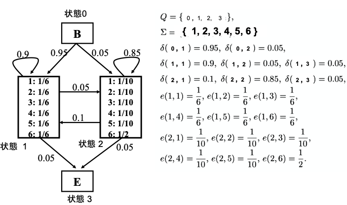

# 隠れマルコフモデルとViterbiアルゴリズム

- 隠れマルコフモデル (HMM)
    - 状態を観測できないマルコフモデル
  - 定義
  - $ M = (Q, \Sigma, \delta, e, p_0, f)$
  - $ Q: 状態の有限集合 = \{0,1,2,...,n,n+1\}$
  - $ \Sigma: 有限アルファベット$
  - $ \delta: Q \times Q \rightarrow 0,1 状態遷移確率$
  - $ e: Q \times \Sigma \rightarrow 0,1 記号の出現確率$
  - $ p_0 : 初期状態. p_0=0$
  - $ f : 最終状態. f=n+1$
    - 初期状態への遷移は存在しない
    - 最終状態からの遷移は存在しない
  - 例
- 
  - 出力(1~6)から状態(1 or 2)を予想したい
  - Viterbiのアルゴリズム
    - `状態数^出力数` 通りのパス各々について確率を計算して、最大のパスが予想された状態
    - 計算量が多い。 DPで工夫
```Viterbi
w : 出力された記号列
v(k,i) : w[1]..w[i] を生成して、状態kで終わる最適パスの確率

計算例
w = abb とする
v(1,1) = max{ δ(0,1) * e(1,a) } 
v(2,1) = max{ δ(0,2) * e(2,a) }

v(1,2) = max{
  δ(0,1) * e(1,a) // 前半部分がDPできる
    * δ(1,1) * e(1,b),
  δ(0,2) * e(2,a) // こっちも
    * δ(2,1) * e(1,b)
}
v(2,2) = ...

再帰式
v(0,0) = 1
v(k,0) = v(0,i) = 0
v(k,i) = max{ v(j,i-1) * δ(j,k) | j = 0..n } * e(k,w[i])


```
